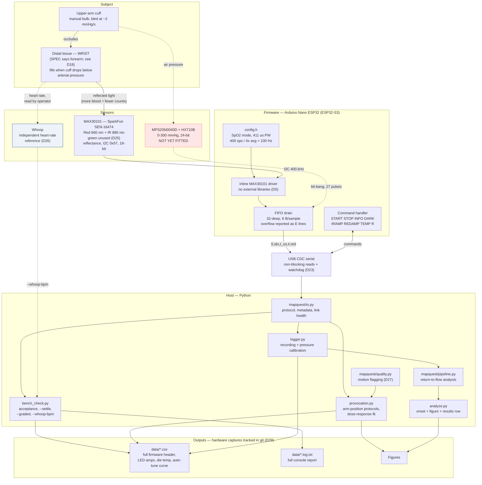
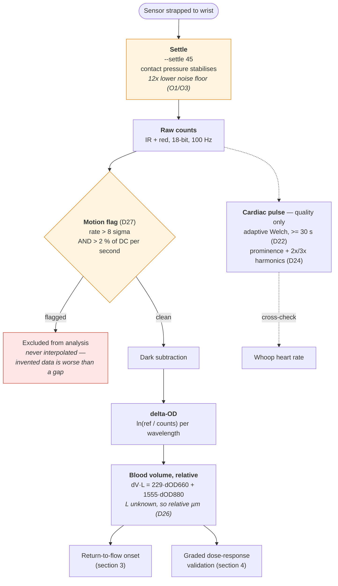
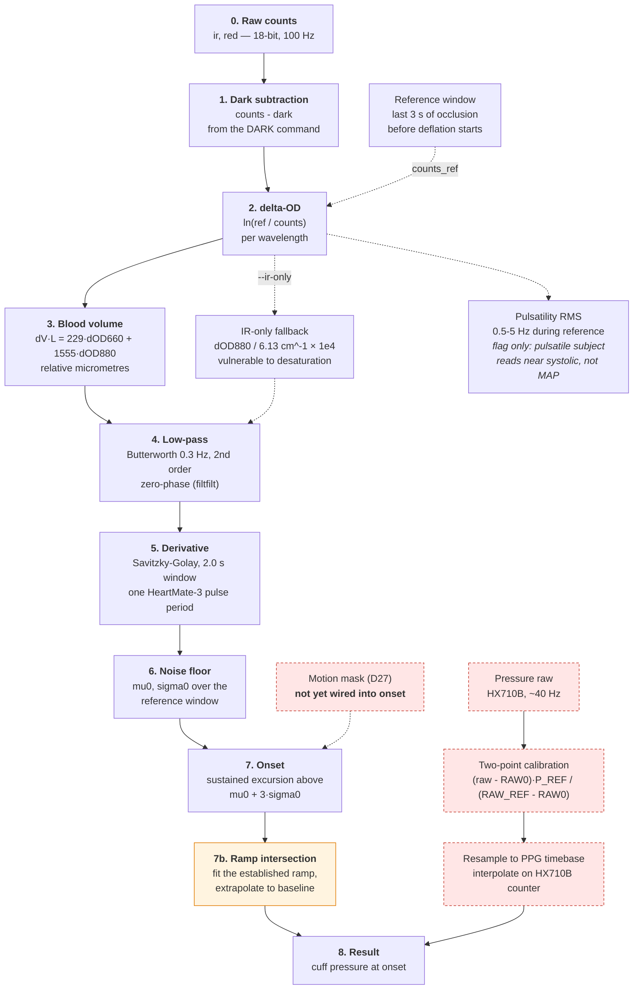
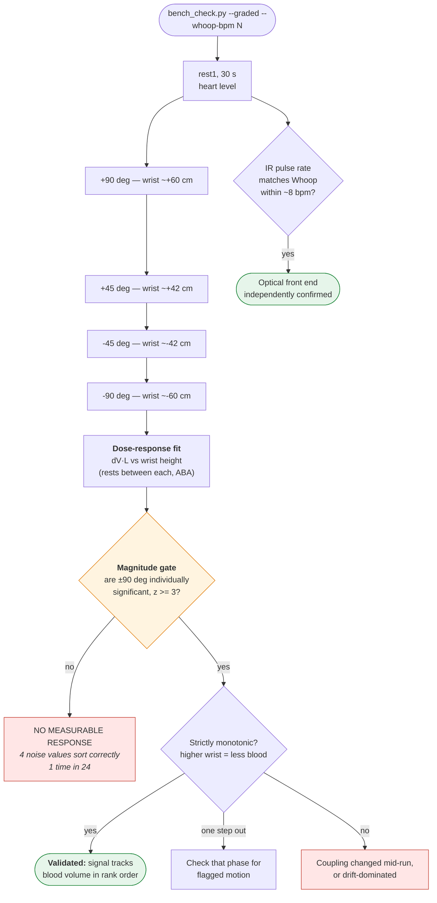
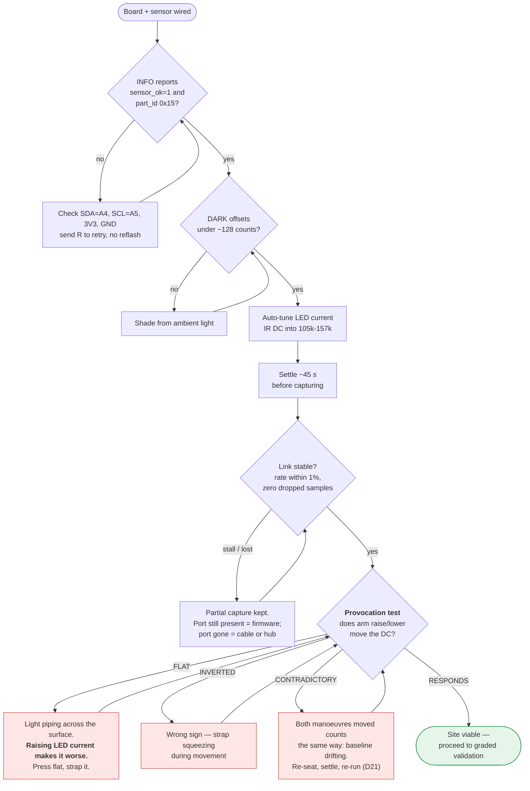
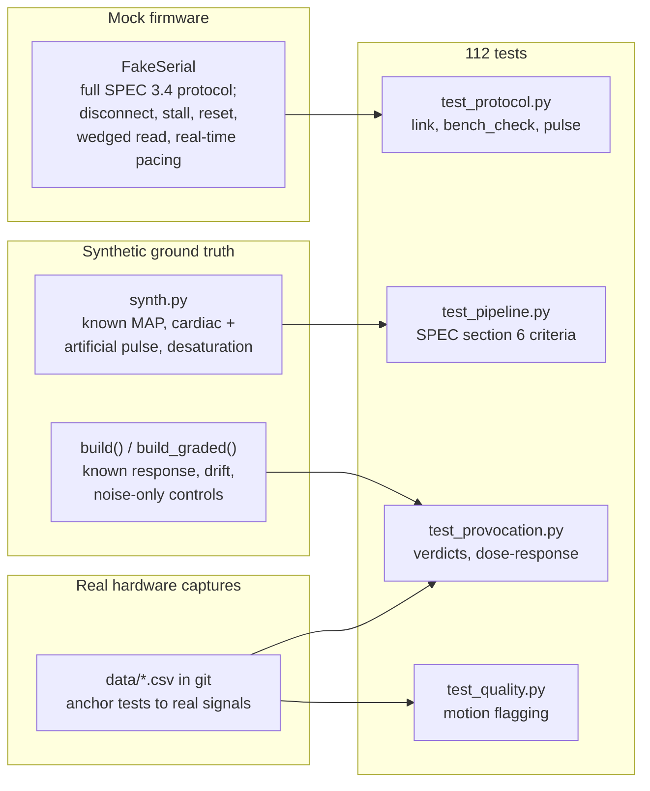

# MAPQuest — Architecture & Signal Pipeline

Living document. Updated as the system changes; see the status table at the bottom for what
is verified on hardware versus only on synthetic data. The reasoning behind each choice
lives in [`decisions.md`](decisions.md).

Last updated: 2026-10-09 — focus shifted to the blood-volume measurement itself (D26);
added motion flagging (D27) and the graded dose-response validation (D28).

---

## 1. End-to-end system

---

## 2. Blood-volume measurement — the core of the system

The current focus (D26). Everything else in MAPQuest is built on this signal being right.
Accuracy target is **relative and monotonic**: proportional to true volume change and
repeatable, with an arbitrary absolute scale.

**Measured on hardware (2026-10-09, settled 60 s wrist capture):** onset threshold
**0.627 µm/s**; red drift 2.0× IR (was 90× before settling); motion flagger 0 false events.

---

## 3. Return-to-flow signal pipeline

The measurement detects **slow venous filling**, not the cardiac pulse. The pulse is roughly
an order of magnitude smaller and is treated only as a quality flag.

**Orange** = deliberate deviation from SPEC §5.1 (D10). The spec's threshold-crossing onset
reads ~2.6 mmHg high, because the 0.3 Hz zero-phase filter and the 2 s Savitzky–Golay window
are both symmetric kernels and smear the ramp corner backwards in time. `--onset-method
intersect` fits the established ramp and extrapolates back, landing within ±0.2 mmHg.

**Red dashed** = not yet built or not yet fitted. The motion mask exists and is used by the
provocation analysis, but onset detection does not consult it yet — so a motion transient
during a real deflation could still be read as filling.

---

## 4. Validation — how we know the volume signal is right

There is no reference instrument for blood volume, so validation leans on physics that is
predictable from geometry alone (D28).

Rank order is judged by Spearman correlation; linearity (R²) is reported but not required,
because venous compliance is itself non-linear.

---

## 5. Diagnostic path — what we run before trusting a recording

---

## 6. Test layer

---

## 7. Status

| Layer | State | Evidence |
|---|---|---|
| Firmware — PPG | **working on hardware** | 100 Hz, zero dropped samples over 60 s, part id 0x15 |
| Firmware — pressure | written, never run | compiles under `PRESSURE_ENABLED=1` only |
| Serial link | **working, with known stall** | stalls caught and partial data kept (D23); root cause parked |
| Blood-volume signal | **responds on hardware** | wrist provocation z=37.8 / 19.2 (raw data lost, D29) |
| Noise floor | **good on hardware** | 0.627 µm/s settled, ~22× headroom vs arm-raise response |
| Motion flagging | **working on hardware** | 0 false events on still capture; 4/4 movements caught |
| Graded dose-response | built, **not yet run on hardware** | synthetic + mock only |
| Whoop HR cross-check | built, **not yet run on hardware** | mock only |
| Return-to-flow pipeline | synthetic only | ±0.2 mmHg on synthetic ground truth |
| Pressure calibration | never run | no HX710B |

### Open issues

| Issue | Impact |
|---|---|
| Graded dose-response not yet run on a real arm | the D26 accuracy claim is still unvalidated |
| Motion mask not wired into return-to-flow onset | a transient during deflation could be read as filling |
| Serial stall with port still present — parked by user | costs retries; would ruin a real deflation mid-measurement |
| ΔV·L is relative (unknown path length) | fine for D26; reopens if absolute volume is ever needed |
| No HX710B | onset *time* only; no pressure, so no MAP |

### Resolved since last update

| Was | Resolution |
|---|---|
| Red drifts ~90× more than IR | contact settling, not LEDs — 2.0× after `--settle` (O1) |
| Onset noise floor ~7.7 µm/s | 0.627 µm/s settled, 12× better (O3) |
| `synth.py` ramp below real noise floor | it's 4.8× above the settled floor (O2) |
| Cardiac rate unstable between settings | Welch averaged ~1 segment; adaptive window + 30 s minimum (D22) |
