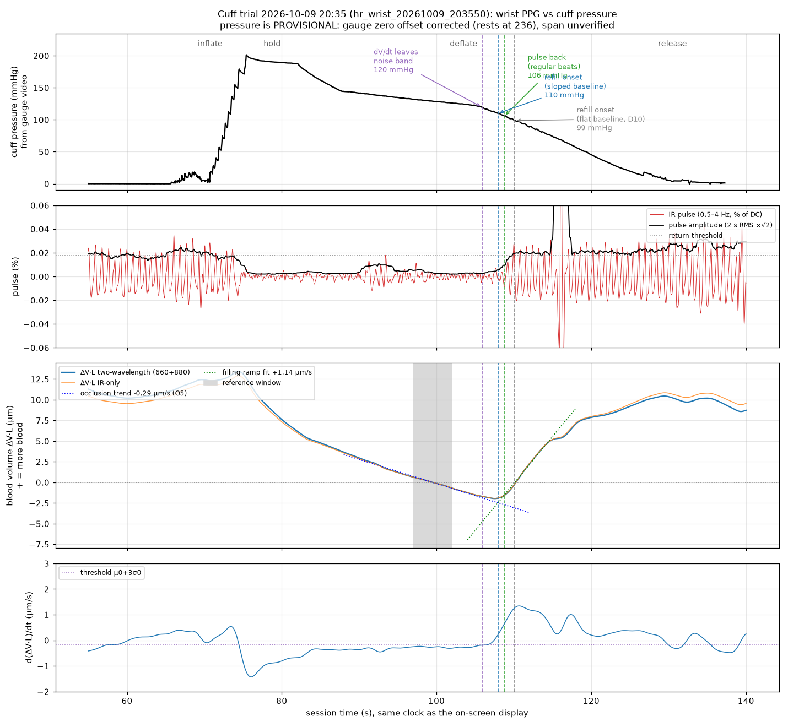

# MAPQuest — Decision Log

Every non-obvious choice, why it was made, and what it costs. Entries are append-only:
when a decision changes, the old entry is marked **superseded** rather than edited, so the
reasoning that led there stays visible.

**Add an entry whenever:** a choice deviates from [`SPEC.md`](SPEC.md), a default is picked
that someone could reasonably pick differently, a bug reveals a wrong assumption, or an
experiment settles something.

| # | Decision | Status |
|---|---|---|
| [D1](#d1) | Red + IR, not green | accepted |
| [D2](#d2) | ~~Green + IR for best waveform quality~~ | **superseded by D1** |
| [D3](#d3) | SpO₂ mode rather than Multi-LED | accepted |
| [D4](#d4) | 400 sps internal + 4× averaging → 100 Hz | accepted |
| [D5](#d5) | Inline MAX30101 driver, no SparkFun library | accepted |
| [D6](#d6) | ASCII CSV over USB CDC, not binary | accepted |
| [D7](#d7) | `idx / fs` is the master clock, not `t_us` | accepted |
| [D8](#d8) | Zero-phase filtering (`filtfilt`) | accepted |
| [D9](#d9) | Savitzky–Golay derivatives, not `np.diff` | accepted |
| [D10](#d10) | Onset by ramp intersection, not threshold crossing | accepted — **deviates from SPEC §5.1** |
| [D11](#d11) | IR-only fallback converted to micrometres | accepted — bug fix |
| [D12](#d12) | `R` retry command added | accepted — **extends SPEC §3.4** |
| [D13](#d13) | `sensor_ok` reported in `INFO` | accepted — **extends SPEC §3.4** |
| [D14](#d14) | Pulse detection by spectral prominence | accepted — bug fix |
| [D15](#d15) | Arm-raise provocation is the viability gate | accepted — **not in SPEC** |
| [D16](#d16) | ABA design in the provocation protocol | accepted |
| [D17](#d17) | Typed link errors and partial-capture salvage | accepted |
| [D18](#d18) | **Measurement site: wrist, not ventral forearm** | accepted — **deviates from SPEC §2.1/§8** |
| [D19](#d19) | Pressure path compiled out behind a flag | accepted |
| [D20](#d20) | Explicit LED currents + die-temperature bracketing | accepted |
| [D21](#d21) | A wrong-signed manoeuvre vetoes a 'responds' verdict | accepted — bug fix |
| [D22](#d22) | Pulse detection needs >= 30 s and an adaptive Welch window | accepted — bug fix |
| [D23](#d23) | Non-blocking serial reads + watchdog | accepted — bug fix |
| [D24](#d24) | ~~Harmonic series as pulse evidence~~ | **superseded by D30** |
| [D25](#d25) | Green evaluated as a third channel, declined | accepted |
| [D26](#d26) | Scope: relative & monotonic accuracy, 2–5 min, detect-and-flag motion | accepted — **user's call** |
| [D27](#d27) | Motion flagged by speed: sigma test plus an absolute floor | accepted |
| [D28](#d28) | Graded dose-response as the validation, with a magnitude gate | accepted |
| [D29](#d29) | Hardware captures are tracked in git | accepted — after data loss |
| [D30](#d30) | Harmonics are informational only; a pulse needs ≥6 dB on its own | accepted — reverses D24 |
| [D31](#d31) | Coupling slips detected inside holds; affected manoeuvres excluded | accepted |
| [D32](#d32) | Run inputs in the CSV header; console log written through | accepted — bug fix |
| [D33](#d33) | Standalone heart-rate monitor: only show a corroborated number | accepted |
| [D34](#d34) | Live blood-volume tab; one LED tuning for both tabs | accepted |
| [D35](#d35) | Volume noise floor: rolling envelope band with hysteresis | accepted — fixes D34 |
| [D36](#d36) | Heart rate averaged over a sliding time window | accepted |
| [D37](#d37) | Recordings carry session_t0 so events align with raw rows | accepted — bug fix |
| [D38](#d38) | Cuff pressure read from a phone video of the gauge beside an on-screen clock | accepted — **user's proposal** |
| [D39](#d39) | Onset intersects the ramp with a sloped occlusion baseline; threshold needs net filling | accepted — resolves O5 |
| [D40](#d40) | MPRLS pressure sensor, tested standalone before joining the PPG bus | accepted — bench test |
| [D41](#d41) | MPRLS joins the PPG stream; replaces the HX710B plan | accepted |
| [D42](#d42) | Reference BP and cuff-to-sensor distance recorded with every trial | accepted |
| [O1](#o1) | Red channel drift — cause and mitigation | **resolved** |
| [O2](#o2) | `synth.py` noise defaults vs hardware | **reopened** — real filling ~3× slower than simulated |
| [O3](#o3) | Is the onset noise floor low enough to work? | **yes on first cuff run, but margin ~2×, not 22×** |
| [O4](#o4) | Red is the contact-sensitive channel — two-wavelength vs IR-only | **open** |
| [O5](#o5) | Blood volume is not flat under occlusion — onset baseline must be sloped | **resolved by D39** |

---

## D1 — Red (660 nm) + IR (880 nm), not green

**Status:** accepted · 2026-10-05

**Context.** The MAX30101 carries green, red and IR. Only two channels are needed.

**Decision.** Red + IR. Green is left unused.

**Why.** SPEC §5.1 step 6 converts optical density into blood volume with
`ΔV·L = 229·ΔOD₆₆₀ + 1555·ΔOD₈₈₀`. Those coefficients are tied to haemoglobin extinction at
660 and 880 nm; there is no green coefficient to substitute. More importantly the Hb−HbO₂
extinction difference is **+2906 cm⁻¹/M at 660 nm and −488 cm⁻¹/M at 880 nm** — the sign flip
is what lets the pair cancel desaturation of trapped blood. Green sits where oxy and deoxy
absorb almost equally, so it carries nearly no saturation information and cannot play either
role. Green's 0.3–0.8 mm penetration would also largely miss the bulk filling being measured.

**Consequences.** Locked into SpO₂ mode (see D3). Green remains available for *diagnostics*
if coupling ever needs a more sensitive probe — that would not affect the measurement path.

Full reasoning and sources: [`led-selection-report.md`](led-selection-report.md).

---

## D2 — ~~Green + IR, for best reflectance waveform quality~~

**Status:** **superseded by D1** · 2026-10-05

**What was decided.** Green + IR in Multi-LED mode, on the general reflectance-PPG literature:
green has the best AC/DC ratio, highest SNR, and sharpest dicrotic notch.

**Why it was wrong.** It optimised for *pulsatile waveform quality at a fingertip*, which was
the stated goal before `SPEC.md` arrived. The actual measurement is return-to-flow MAP built
on a two-wavelength Beer–Lambert solve, where green is not merely worse but unusable. The
research was sound; it answered the wrong question.

**Lesson.** Confirm the measurement model before optimising the front end. The literature's
"best" depends entirely on what is being measured.

---

## D3 — SpO₂ mode rather than Multi-LED

**Status:** accepted · 2026-10-05

**Decision.** `MODE[2:0] = 0b011` (SpO₂), which drives exactly Red + IR.

**Why.** Follows from D1. Multi-LED would work but needs explicit slot configuration for no
benefit. One trap recorded for posterity: on the MAX30101, **"Heart Rate mode" is Red-only,
not green-only** — people arriving from the MAX30102 (which has no green) routinely assume
otherwise. Green is reachable *only* through Multi-LED.

**Consequences.** FIFO layout is fixed at Red-then-IR, 3 bytes each. Verified against the
datasheet (p.15: "3 bytes for RED, 3 bytes for IR") and SparkFun's reference implementation.

---

## D4 — 400 sps internal with `SMP_AVE = 4`, giving 100 Hz output

**Status:** accepted · 2026-10-05

**Context.** SPEC §3.1 asks for 100 Hz. Datasheet Table 11 caps two-channel operation at
**400 sps** when the pulse width is 411 µs (the setting that gives full 18-bit resolution).

**Decision.** Run the ADC at its 400 sps ceiling and average 4 samples in hardware.

**Why.** Output rate and internal rate are separable. Running the ADC at 100 sps would meet
the spec while discarding the headroom; spending it on averaging buys roughly a 2× noise
reduction for free. The measurement is a slow DC trend whose detection threshold is set
directly by the noise floor, so this is the right place to spend it.

**Consequences.** Changing the output rate means changing `SAMPLE_AVERAGING`, not
`SAMPLE_RATE_SPS`. Both live in `config.h` and are echoed into every recording header.

---

## D5 — Inline MAX30101 driver, not the SparkFun library

**Status:** accepted · 2026-10-05 *(rationale recovered 2026-10-06 — see note)*

**Decision.** The sketch talks to the sensor directly over `Wire`. No external libraries.

**Why.**
1. **No install step.** Open the `.ino` in Arduino IDE and upload.
2. **The SparkFun library names its FIFO getters by slot position, not by LED.**
   `getFIFORed()` returns whatever sits in slot 1. Put green in slot 1 and `getFIFORed()`
   returns green. For a project whose correctness depends on knowing which wavelength
   produced which number — the two-wavelength solve weights them 229 vs 1555 — that is a
   serious footgun.
3. Full control over the slot and averaging configuration D3/D4 depend on.

**Consequences.** ~200 lines of register code to maintain, and the datasheet is the only
reference. Compile-verified on every change via the `arduino-cli` bundled inside Arduino IDE.

> **Note.** This rationale was lost when `docs/design.md` was deleted during the restructure
> to match SPEC's layout, and recovered from git history (`782fbd5`) on 2026-10-06. It is the
> reason this decision log exists.

---

## D6 — ASCII CSV over USB CDC, not a binary protocol

**Status:** accepted · 2026-10-05

**Decision.** `S,<idx>,<t_us>,<ir>,<red>` as text.

**Why.** At 100 Hz × 2 channels this is roughly 3 kB/s — nowhere near a USB CDC bottleneck.
Text is debuggable from any serial monitor, which matters a great deal during bring-up. The
bandwidth saved by a binary format buys nothing here.

**Revisit if** the sample rate rises substantially or more channels are added.

---

## D7 — `idx / fs` is the master clock; `t_us` is diagnostics only

**Status:** accepted · 2026-10-05 (follows SPEC §3.3)

**Why.** `t_us` is `micros()` at the moment the host drained a FIFO *burst*, so every sample
in that burst shares a timestamp. It is not the conversion time. Using it as a timebase would
quantise time into bursts. The sample index divided by the configured rate is uniform and
correct.

**Consequences.** `t_us` is still recorded, and is what SPEC §3.5 uses to verify output rate
and detect jitter. Measured on hardware at **99.37 Hz vs 100 configured (−0.63 %)** — within
spec, and benign, because pressure is attached per-PPG-sample so the small scale error
cancels when reading pressure at the onset.

---

## D8 — Zero-phase filtering (`sosfiltfilt`)

**Status:** accepted · 2026-10-05

**Why.** A causal filter imposes a frequency-dependent group delay, which would shift the
onset in time and therefore bias the reported pressure. Offline we can afford to be
non-causal and avoid the question entirely.

**Consequences.** The pipeline needs the whole buffer, so it is not real-time. SPEC §5.3's
real-time variant must instead subtract a known delay (≈1.75 s ≈ 3.5 mmHg at 2 mmHg/s).
**Zero-phase is not zero-smearing** — see D10, which exists because of exactly that
confusion.

---

## D9 — Savitzky–Golay derivatives, not finite differencing

**Status:** accepted · 2026-10-05

**Why.** Finite differencing multiplies high-frequency noise by ω per derivative. SG fits a
local polynomial and differentiates it analytically, smoothing and differentiating in one
well-conditioned step. The 2.0 s window is one HeartMate-3 artificial-pulse period, so it
cancels that component and its harmonics — keeping the pipeline valid on LVAD data without
re-tuning (SPEC §5.1).

---

## D10 — Onset by ramp intersection, not threshold crossing

**Status:** accepted · 2026-10-05 · **deviates from SPEC §5.1 step 10**

**Context.** The spec defines onset as the first sample of a sustained excursion above
`μ₀ + 3σ₀`, and SPEC §6 requires accuracy within **±1 mmHg**.

**Problem.** The spec's own method cannot meet the spec's own criterion. Measured at
**+2.6 mmHg** on synthetic ground truth. The cause is structural, not noise: the 0.3 Hz
zero-phase low-pass and the 2 s SG window are both *symmetric* kernels, so they smear the
ramp's corner backwards in time as well as forwards. The derivative starts climbing before
filling actually begins. Confirmed by sweeping the window: 0.5 s → +2.16, 2 s → +2.56,
4 s → +3.70 mmHg.

**Decision.** Default to `--onset-method intersect`: fit the established ramp and extrapolate
back to where it meets the occlusion baseline. Because it uses the ramp's slope and offset
rather than the location of its corner, smearing cancels. Measured error **−0.15 mmHg**.

**Consequences.** Both estimators are always computed and both printed, so the difference
stays visible. `--onset-method threshold` gives literal spec behaviour.
**This is a candidate spec amendment** — flagged for the user, not yet resolved.

---

## D11 — IR-only fallback converted to micrometres

**Status:** accepted · 2026-10-05 · bug fix

**Problem.** SPEC §5.1 step 6 states the fallback as `ΔOD₈₈₀ / 6.13 cm⁻¹`, which yields
**centimetres**, while the two-wavelength branch yields **micrometres**. Implemented
literally, the two paths sat 10⁴ apart, making any shared threshold, comparison or plot
meaningless.

**Decision.** Convert the fallback to µm (`×1e4`).

**Sanity check.** `1e4 / 6.13 = 1631 µm/OD` lands close to the two-wavelength `COEFF_IR_880`
of 1555 — the fallback is the same formula with the red term dropped, which is the
confirmation the conversion is the right way round.

---

## D12 — `R` retry command

**Status:** accepted · 2026-10-06 · **extends SPEC §3.4**

**Decision.** `R` (or `RETRY`) re-probes and reconfigures the sensor at runtime.

**Why.** Bring-up involves wiring mistakes. Without this, every fix costs a reflash. Cheap to
add, materially faster to iterate.

---

## D13 — `sensor_ok` reported in `INFO`

**Status:** accepted · 2026-10-06 · **extends SPEC §3.4** · bug fix

**Problem.** The firmware printed `part_id=0x%02X` using `EXPECTED_PART_ID`, the compile-time
constant — so with **no sensor attached at all**, `INFO` still reported `part_id=0x15` and the
bench check passed "MAX30101 found at 0x57".

**Decision.** Report the id actually read, plus an explicit `sensor_ok` flag. `START` is
refused when it is false, rather than streaming a plausible-looking flat line.

**Host note.** A missing `sensor_ok` field parses as `None`, not `False` — older firmware
must not be mistaken for a failure.

---

## D14 — Pulse detection by spectral prominence

**Status:** accepted · 2026-10-06 · bug fix

**Problem.** The detector took the largest in-band FFT bin and compared it to a distant
5–20 Hz noise floor. On a drift-dominated recording the spectrum falls monotonically, so the
argmax lands on the band's **lower edge** and the comparison reports a large SNR for a pulse
that does not exist. It confidently reported "45 bpm, 27 dB" on a recording with no pulse.

**Decision.** Require a genuine local peak with prominence, measured against its own
neighbourhood. A 1/f spectrum has no local maxima, so it correctly yields nothing.

**Verified.** Synthetic 1/f drift → 2.5 dB (rejected); real 0.15 % pulse → 18.4 dB (accepted).

**Consequence.** Conservative: a weak real pulse buried in drift is reported as absent. That
is the right failure direction — see D15, where the pulse is advisory anyway.

---

## D15 — The arm-raise provocation test is the viability gate

**Status:** accepted · 2026-10-06 · **not in SPEC**

**Context.** Every SPEC §3.5 acceptance criterion passes with the photodiode staring at a
wall. The first wrist attempt met them all while showing a perfusion index of 0.024 % — no
usable signal.

**Decision.** Gate on whether DC responds to a deliberate blood-volume change: raise the arm
(venous drainage), lower it (pooling), with rests between.

**Why not the cardiac pulse.** The measurement detects slow venous filling, which is roughly
an order of magnitude larger than the cardiac AC. A site can be perfectly viable while
showing no resolvable heartbeat, so gating on a pulse would reject working setups. Borne out
on hardware: the pulse was undetectable, while the provocation response was **z = 37.8**.

**Sign convention.** More blood → more absorption → **fewer** counts. Arm up raises counts.
A response with the wrong sign is flagged as its own failure mode, not a pass.

---

## D16 — ABA design in the provocation protocol

**Status:** accepted · 2026-10-06

**Decision.** Rest before *and* after each manoeuvre; compare each manoeuvre to the mean of
the two surrounding rests.

**Why.** Baseline drift at these timescales is large — ~1,400 counts over 60 s was measured.
Comparing a manoeuvre only to the rest preceding it would read that drift as a response.
Verified: 1,500 counts of pure linear drift with no real response classifies as **flat**
(z = 0.4).

**Also:** only the last 50 % of each phase is used, because venous volume settles over several
seconds and averaging the transient would understate the effect.

**Known limitation.** If the baseline does not recover after a manoeuvre, the correction
underestimates it. Observed on 2026-10-06: `rest3` never returned to baseline, so the
arm-down effect was reported as −1,769 counts where against `rest2` alone it is −3,528.

---

## D17 — Typed link errors and partial-capture salvage

**Status:** accepted · 2026-10-06

**Problem.** Once streaming began, an empty read just continued the loop — a silent board
spun forever with no diagnosis. A disconnect raised a bare pyserial traceback and discarded
the whole capture.

**Decision.** `LinkLost` (port gone) and `LinkStalled` (port open, firmware silent) carry the
sample count and port diagnostics. Captures that die partway are kept and analysed, with the
failure reported alongside.

**Why distinguish them.** They point at different causes: `LinkLost` means cable or
re-enumeration; `LinkStalled` means the OS still has the device, so suspect the sketch.

---

## D18 — Measurement site: wrist, not ventral forearm

**Status:** accepted · 2026-10-06 · **deviates from SPEC §2.1 and §8**

**Context.** SPEC §2.1 specifies "PPG on ventral forearm, 5–10 cm below cuff edge" and §8
repeats it in the trial procedure. The forearm attempt gave a perfusion index of 0.024 % and
no detectable response.

**Decision.** Use the wrist for the time being. **User's call**, made 2026-10-06.

**Concern raised before the decision.** The wrist is the site where Red/IR is weakest —
commercial wrist heart-rate sensors all use green, because green's AC/DC ratio and shallow
penetration suit the wrist's superficial capillary bed. Red/IR there is the hardest
combination.

**Outcome — the concern did not materialise.** The provocation test passed decisively:
arm-up **+3.31 % of DC, z = 37.8**; arm-down **−1.72 %, z = 19.2**; both correct sign. The
site responds to blood volume far more strongly than the forearm attempt did.

**Consequences and open risks.**
- Return-to-flow remains valid: the wrist is still distal to an upper-arm cuff, so it fills.
- Filling **volume and time course will differ** from the forearm — more tendon and bone, less
  muscle. Any filling-rate figure borrowed from forearm venous-occlusion literature does not
  transfer.
- SPEC §8's trial procedure needs updating if wrist becomes permanent.
- The red channel's drift (O1) was measured at the wrist and may be site-specific.

**Revisit if** the forearm is retried with better mechanical coupling, or if O1 traces the red
drift to something about this site.

---

## D19 — Pressure path compiled out behind `PRESSURE_ENABLED`

**Status:** accepted · 2026-10-05

**Decision.** HX710B support is written but `#if`-d out, defaulting off. With it off the
firmware omits the pressure fields from `S` lines and the host records PPG only.

**Why.** The sensor is not owned yet. Writing it now while the datasheet details are fresh —
the 60 µs SCK ceiling, the 27-pulse mode select — is cheaper than returning later. Compiling
both paths on every change keeps the disabled branch from rotting.

**Caveat.** Compiled, never executed. The timing-critical parts are exactly the ones a
compiler cannot check.

---

## D20 — Explicit LED current flags and die-temperature bracketing

**Status:** accepted · 2026-10-06

**Context.** O1 needs a controlled experiment: vary red LED current, hold everything else
fixed, compare drift. Auto-tune picks currents on its own, so it cannot answer the question.

**Decision.**
- `--ir-amp` / `--red-amp` on `bench_check.py` set currents explicitly and exclude that
  channel from `--auto-tune`, so one channel can be pinned while the other is tuned.
- Every capture is bracketed by a `TEMP` reading, and the rise is reported and written into
  the header.

**Why the temperature.** The self-heating hypothesis for O1 was inferred, not measured.
Datasheet Table 13 gives up to 8 °C rise at high LED current and duty cycle, and red output
and wavelength both move with it. Reading the die directly turns a hypothesis into a
measurement, and costs one serial command either side of the run.

**Also fixed here.** The plain-capture CSV writer still emitted only three header lines —
the same gap already fixed for provocation captures. Both now write the full firmware
header, so any two recordings are comparable.

**And: results that only existed on screen are now saved.** `--save` also writes a `.log.txt`
of the full console report, and the auto-tune trajectory (the amp → DC pairs) goes into the
CSV header as `autotune_<channel>`. That trajectory is a DC-versus-LED-current curve — real
data bearing directly on O1 — and it was previously printed and discarded. Warnings, verdicts
and tuning steps live nowhere else, so without this a run could not be reviewed after the
fact or shared.

---

## D21 — A strongly wrong-signed manoeuvre vetoes "responds"

**Status:** accepted · 2026-10-09 · bug fix

**Problem.** The verdict returned `responds` if *any* manoeuvre had the right sign and
z ≥ 3, without checking whether another had the wrong sign. On a run from 2026-10-06 both
manoeuvres drove counts **down** — arm-up by −6.5 %, arm-down by −10.4 % — because the strap
was settling monotonically through the capture. Arm-down happened to agree with that drift,
so the run was reported as a working sensor.

**Decision.** A new `contradictory` verdict. `responds` now requires at least one strong
correct effect **and no strong wrong-signed one**.

**Why it matters.** This is the exact failure the provocation test exists to catch. A
monotonic baseline shift makes whichever manoeuvre points the same way look correct, so the
test was vulnerable to the artifact it was designed to detect.

**How to recognise it in the raw trace:** both manoeuvres moving counts the same direction.
Re-seat the sensor, let it settle, re-run.

---

## D22 — Pulse detection requires ≥30 s, with an adaptive Welch window

**Status:** accepted · 2026-10-09 · bug fix

**Problem.** `nperseg` was fixed at 8 s. On a 10 s capture that averages **one** segment —
a raw periodogram, whose variance equals its mean — so "prominence" was measured on noise.
The same 10 s record from 2026-10-09 reported **195, 255 or 30 bpm** depending only on the
segment length chosen. Across channels it gave 195 bpm on IR and 172 on red, which a real
pulse cannot do.

**Decision.**
- `nperseg = clip(len/4, 4 s, 10 s)` — target ~8 averaged segments while keeping resolution
  fine enough to separate a rate from its harmonics.
- Skip the pulse verdict entirely below **30 s of data**, and say why.
- Gate on **data duration, not wall-clock**: a stalled link can burn 60 s and deliver 10 s
  of samples, and it is the sample count that limits the spectrum.

**Result.** The same 10 s capture now reports **75 bpm on both channels** — plausible, and
agreeing across wavelengths, which is the signature of a real pulse rather than noise.

**Consequence.** The 10 s auto-tune run no longer claims anything about pulse. Any capture
meant to answer "is there a pulse" must be ≥30 s.

---

## D23 — Non-blocking serial reads, with a watchdog behind them

**Status:** accepted · 2026-10-09 · bug fix

**Problem.** A 60 s capture froze at 24 s with no error and no traceback — the program just
stopped. D17 had already added a 3 s stall detector, and it never fired.

**Cause.** The stall detector sits *after* `readline()` returns. pyserial's blocking
`readline()` on Windows does not reliably honour its timeout once a USB CDC device vanishes
mid-transfer; the call hangs indefinitely, so the detector never gets a turn. The timeout
being respected was an assumption, not a guarantee.

**Decision.**
1. **Poll `in_waiting` and assemble lines ourselves** instead of calling `readline()`. The
   read never blocks, so the stall timer always runs — and `in_waiting` raises promptly on a
   dead handle, which is the signal we want anyway.
2. **A watchdog thread** as the last line of defence: if nothing arrives for
   `max(4 × stall_timeout, 10 s)` it calls `cancel_read()` and closes the handle from
   outside, turning any remaining hang into an exception. It reports itself distinctly,
   since firing means something wedged *below* our timeout layer.

**Consequence.** `Device.readline()` no longer blocks; it returns `""` when nothing is ready
and sleeps 2 ms to avoid spinning. Callers already loop against their own deadlines, so this
is transparent to them.

**Tested** with a mock whose reads wedge partway through: raises `LinkStalled` in well under
10 s and keeps the samples received before the hang.

---

## D24 — ~~A harmonic series is the strongest evidence of a real pulse~~

**Status:** **superseded by D30** · 2026-10-09

**Context.** Peak prominence alone kept being ambiguous: 4.4 dB on one capture, with no way
to tell a weak real pulse from a lucky noise bump.

**Decision.** After finding the best in-band peak, check for peaks near 2× and 3× it.

**Why.** A PPG beat is sharply peaked, not sinusoidal, so a real pulse necessarily puts
energy at its harmonics. Noise and 1/f drift do not produce a harmonic series. A peak with
harmonics now passes at ≥3 dB where a lone peak still needs ≥6 dB.

**Confirmed on hardware.** The clean 60 s wrist capture gave 78 bpm with peaks at 162 and
234 bpm — the 2nd and 3rd harmonics — turning "is 78 bpm real?" from a judgement call into
an automated check. Red on the same capture showed 126 bpm at 4.3 dB with no coherent
series, correctly staying unconvincing.

---

## D25 — Green evaluated as a third channel, and declined

**Status:** accepted · 2026-10-09

**Question.** Could the unused green LED improve accuracy? This revisits D1, which ruled green
out of the *measurement*; the question here was whether it earns a place as an auxiliary
channel.

**What it would have bought.** Not ΔV·L accuracy — the two-wavelength solve is fixed at
660/880 nm and green has no coefficient. Two real but indirect benefits: motion
discrimination (green at 0.3–0.8 mm vs IR at 1.5–2.5 mm, so a coupling change hits both
while deep filling hits mostly IR), and an independent heart-rate channel to validate the
optical front end against a reference.

**The cost, from datasheet Table 14 (p.26).** Channel-to-channel timing at 411 µs is
**1107 µs**. Three channels need 3,321 µs per sample, which does not fit the 2,500 µs period
at 400 sps; two channels (2,214 µs) do, which is exactly why SpO₂ caps there. Adding green
forces either 200 sps with 2× averaging, or 215 µs at 17-bit — **about 1.4× more noise**
either way, moving the onset threshold from 0.627 to ~0.88 µm/s.

**Decision.** Decline. Protect the measurement channels.

**Why.** The benefits are diagnostic, not measurement accuracy, and both have adequate
substitutes: motion can be flagged from transient speed (D27), and IR already shows a clean
78 bpm with 2nd and 3rd harmonics for the heart-rate cross-check. Paying a permanent 1.4×
noise penalty on the measurement for diagnostic convenience is the wrong trade.

**Revisit if** motion artifacts prove unflaggable from IR/red alone, or if the noise budget
later turns out to have slack we are not using.

---

## D26 — Scope: what "accurately measure blood volume change" means here

**Status:** accepted · 2026-10-09 · **user's call**

Four scoping decisions, taken together because each constrains the others.

| Question | Decision |
|---|---|
| Accuracy target | **Relative and monotonic.** The signal must be proportional to true volume change and repeatable; absolute scale stays arbitrary. |
| Validation | **Graded dose-response** (D28), plus a **Whoop** as an independent heart-rate reference for the optical front end. |
| Stability window | **2–5 minutes** — one full return-to-flow protocol with margin. |
| Motion | **Detect and flag** (D27). Flagged spans are excluded, never repaired. |

**Why relative is enough.** Return-to-flow reads MAP off the *timing* of filling onset; a
constant scale error on ΔV·L cancels. Absolute µm would need the optical path length
(differential pathlength factor), which varies with tissue, wavelength and geometry, and a
reference standard to calibrate against — a known-hard problem that nothing downstream
currently needs.

**Consequence.** ΔV·L remains volume × an unknown path length. Its units are honest only as
*relative* micrometres. Any future claim of absolute volume reopens this decision.

---

## D27 — Motion is flagged by speed, with a sigma test and an absolute floor

**Status:** accepted · 2026-10-09

**Context.** With green declined (D25), motion has to be separated from blood volume without
a depth reference.

**Decision.** Flag a sample when its fractional rate of change is both **> 8 robust sigmas**
*and* **> 2 % of DC per second**. Dilate each span by 0.75 s, merge spans closer than
0.25 s. Exclude flagged samples from analysis; never interpolate across them — an onset
sitting on invented data is worse than a gap.

**Why speed works.** Motion and filling live on different timescales. On real captures a
settled still run never exceeds **1.3 %/s**; genuine arm movement reaches **17 %/s** at the
95th percentile and **187 %/s** at peak. Venous filling is a ramp over seconds.

**Why both tests.** The first version used the sigma test alone and flagged a clean still
capture: on a very quiet signal the robust sigma collapses and ordinary noise clears
8 sigma. The absolute floor sits in the 1.3–17 %/s gap with room on both sides.

**Verified on hardware.** Clean 60 s capture: 0 events. Provocation run: all 4 arm
movements caught. A synthetic −0.1 %/s filling ramp passes through untouched.

---

## D28 — Graded dose-response is the validation, with a magnitude gate

**Status:** accepted · 2026-10-09

**Protocol.** Arm straight, rotated at the shoulder: +90°, +45°, −45°, −90°, with
heart-level rests between (`--graded`, 170 s). Wrist height ≈ arm length × sin(angle), and
hydrostatic pressure is ρgh — predictable from geometry alone. So blood volume should fall
monotonically as the wrist rises. That is the strongest validation available with no
reference instrument, and it tests exactly the D26 target.

`rest1` is 30 s so the cardiac pulse can be resolved there (D22) and compared against the
Whoop via `--whoop-bpm`.

**Judged by rank, not by line.** Spearman correlation asks only whether higher wrist means
less blood. Linearity (R²) is reported but not required — venous compliance is itself
non-linear, so a curve is physiology, not error.

**The magnitude gate — found by the tests.** Four noise values land in perfect descending
order **1 time in 24**. A synthetic flat run (seed 9) produced ΔV·L of
[0.04, 0.03, 0.01, 0.00] µm — Spearman −1.00, "strictly monotonic" — on a recording whose
verdict was *flat*. Rank order alone would certify a dose-response ~4 % of the time with no
response at all. So a dose-response is only **supported** when the extreme positions
(±90°, the largest expected effect) are individually significant, z ≥ 3.

**Expected sign comes from the angle, not the phase name**, so any protocol with angles in
`PHASE_ANGLE_DEG` gets correct sign checks.

---

## D29 — Hardware captures are tracked in git

**Status:** accepted · 2026-10-09 · after data loss

**What happened.** `data/*.csv` was gitignored, and pre-commit cleanups ran
`rm -f data/*.csv data/*.png`. That permanently deleted
`provocation_wrist_20261006_133005` — the run that established the wrist as viable
(z = 37.8). Its numbers survive in D18 and the conversation record, but the raw data cannot
be re-analysed with D27's motion detection or D21's corrected verdict.

**Decision.** Hardware captures are committed. Only regenerable artifacts stay ignored:
`sim_*`, `synth_*`, scratch `_*`, and `results.csv`. A capture of a real arm at a real moment
cannot be regenerated, and at ~180 kB per minute there is no cost argument against keeping
it.

**Rule going forward.** Never bulk-delete `data/`. Remove specific known-scratch files by
name only.

---

## D30 — Harmonics are informational only

**Status:** accepted · 2026-10-09 · **reverses D24**

**What D24 claimed.** That noise and drift do not produce a harmonic series, so a 3–6 dB peak
with peaks near 2× and 3× it could pass as a pulse.

**Why it was wrong.** The implementation matched *any* peak of ≥2 dB prominence within
1.5 bins of 2× or 3×, and a noisy spectrum has dozens of those. Measured directly — the
fraction of arbitrary in-band frequencies that "have harmonics":

| harmonic prominence bar | noisy rest (graded run) | clean 60 s capture |
|---|---|---|
| 2 dB (as implemented) | **62 %** | 69 % |
| 4 dB | 14 % | 34 % |
| 6 dB | 0 % | 21 % |

So the rule mostly certified chance. It passed a 129 bpm "pulse" at 3.5 dB on the graded run
while red, in the same window, put the rate at 104 bpm.

**Decision.** A pulse needs **≥6 dB prominence on its own**. Harmonics are still reported,
with no effect on the verdict.

**What survives.** The clean capture's 78 bpm stands on its own 14.3 dB, and its harmonics at
162 bpm (8.4 dB) and 234 bpm (5.9 dB) are genuinely prominent — consistent with a real
pulse, but no longer counted as proof of one.

---

## D31 — Coupling slips are detected inside holds, and the comparisons they break are excluded

**Status:** accepted · 2026-10-09

**What happened.** The first graded run (2026-10-09 17:01) slipped **6.5 s into the +90°
hold**: both channels stepped down ~7 % in under a second and never returned. Venous
drainage moves counts *up*, smoothly. The run was reported CONTRADICTORY and NOT MONOTONIC —
which reads as the signal being wrong, when the sensor had moved.

**Why the motion detector missed it.** The arm-raise and the slip were one continuous
flagged span, and spans were classified by where they *started* — at the transition.

**Decision.** After a 5 s allowance for each transition, compare medians of consecutive
1 s windows on every channel. A jump over **1 % of DC** is a slip. Real settling moves
~0.1 %/s; a slip moves several percent in under a second. Medians ignore the spikes that
accompany the slip itself.

A slip excludes exactly the comparisons that straddle it — the manoeuvre it occurred in, or
one whose bracketing rest it shifted. Phases entirely after it share the new coupling and
remain valid. If an extreme position is excluded, the dose-response is reported
**COMPROMISED**: neither supported nor refuted.

**Verified.** Finds exactly one slip on the graded run — up90 at 36.4 s, −7.1 % — and none
on the clean capture. Ignores a 3 % exponential settle and steps at transitions.

---

## D32 — Run inputs live in the CSV header; the console log writes through

**Status:** accepted · 2026-10-09 · bug fix

The graded run has no `.log.txt`. The log was buffered and written at exit, so a process
killed while the plot window was open lost it — and with it the Whoop reading and arm
length, which existed nowhere else.

The log now writes through to disk line by line, and `protocol`, `arm_cm` and `whoop_bpm` are
written into the CSV header, so the capture is self-contained either way.

---

## D33 — Standalone heart-rate monitor: show a number only when it is corroborated

**Status:** accepted · 2026-10-09

**What.** `host/hr_monitor.py`, a live GUI, with the processing in
`host/mapquest/heartrate.py`. Independent of the return-to-flow tooling.

**Standard pipeline.** Causal 4th-order Butterworth band-pass, 0.5–4 Hz, with filter state
carried across blocks (zero-phase needs the future, so D8 does not apply live). Inverted,
since reflectance systole is a trough. Peaks with a 0.3 s refractory period and an adaptive
prominence, accepted only once 0.6 s old, refined sub-sample by parabolic interpolation.
Intervals gated to 0.3–2.0 s and to within 30 % of the running median; four rejections in a
row reset the history. HR = 60 / median of the last 9 good intervals.

**Three safeguards the tests forced — without them the monitor showed confident wrong numbers:**

1. **Pulse SNR gate.** The beat detector's threshold is relative to the signal, so it finds
   "beats" in pure noise. In-band power is now compared with the white-noise floor measured
   above 10 Hz; below 3, no peaks are accepted. Noise reads ~1.3, a fingertip ~50, the real
   wrist capture ~10.

2. **Spectrum on raw data, judged by concentration.** First version: Welch on the
   *band-passed* signal. Filtered white noise takes on the filter's shape, an in-band hump
   between steep stopband walls, and pure noise passed a 6 dB prominence test **100 %** of
   the time, at up to 41 dB. Moving to the raw signal still left 85 % passing at 10 dB:
   a 12 s window averages only a few segments, and prominence measured against their random
   dips is meaningless (the D22 lesson again). **Spectral concentration** — fraction of
   in-band power within 0.15 Hz of the peak — separates cleanly: noise never exceeded 0.30;
   real pulses 0.44–0.71.

3. **Corroboration, persisting 3 s.** Drift's tail reaches into the pulse band, raising SNR,
   and its wiggles time as beats. With beat HR shown uncorroborated, pulse-free drift
   produced a number in **310 of 390** seconds. Requiring beat and spectral estimates to
   agree within 8 bpm cut that to 7; requiring that agreement for 3 consecutive seconds cut
   it to **0**, at the cost of a first reading after ~11 s.

**Verified.** Synthetic: within 2 bpm from 48 to 170 bpm; reacquires a 60→100 bpm change;
ignores missed beats; RMSSD within 8 ms of a known rhythm; identical beats regardless of
block size. Real 60 s wrist capture: shown in 44 of 44 seconds after warm-up, median
79.3 bpm against 78 from the full-minute spectrum, with clear systolic peaks and dicrotic
notches in the filtered waveform.

**Open.** No reference comparison yet — the Whoop is the obvious one, and the monitor's
Record button saves a per-second HR log to compare against. RMSSD from 100 Hz wrist PPG
(92 ms on the real capture) is likely inflated by timing jitter; treat it as indicative.

---

## D34 — Live blood-volume tab, sharing one LED tuning with heart rate

**Status:** accepted · 2026-10-09

**What.** A second tab in the monitor, backed by `host/mapquest/volume.py`: the streaming
counterpart of the offline pipeline. Dark subtraction → 0.3 Hz low-pass → ΔOD against a
reference → two-wavelength ΔV·L (relative µm, D26) → rate over a 2 s window → FILLING /
DRAINING / STABLE using the offline rule, μ0 ± 3σ0 held for 2 s. Two-wavelength and IR-only
are drawn side by side, with each channel's percent change, because which to trust is O4.

**Live forced three differences from offline:**
- **Causal low-pass**, so the trace lags ~0.75 s. Fine for watching; onset timing is still
  measured offline with zero-phase filtering (D8).
- **Operator-set reference.** "Zero" takes the last 3 s; it is also set automatically 10 s
  after connecting or re-tuning, once the filter has settled.
- **The noise floor comes from the 10 s after each zero.**

**One tuning for both tabs — the user's question.** Yes: both want DC mid-scale, heart rate
for SNR and blood volume for headroom, since filling lowers counts and draining raises
them. Two changes followed. Auto-tune now sets **red as well as IR**, which the two-wavelength
solve needs and the heart-rate monitor had ignored. And because a re-tune changes counts
with no change in blood, it **interrupts** the volume trace — history kept, gap and marker
inserted, baseline re-zeroed — and is **refused while recording** (SPEC §9's rule, enforced
in software). DARK is now measured on connect (SPEC §5.1 step 3).

**Motion** uses D27's 2 %/s floor, applied to the *low-passed* channels — a strong fingertip
pulse alone has a raw slope near 8 %/s and would otherwise read as motion.

**Verified.** Against synthetic ground truth: within 1.5 µm, rate 2.97–3.01 µm/s for a
3.0 µm/s ramp, FILLING reported 3 s after true onset (filter lag + rate lag + 2 s hold),
STABLE before. Real still capture: STABLE throughout, no false filling. Real graded run: the
36.4 s slip appears as a +100 µm jump, flagged as motion as it happens. Identical history
regardless of block size, after a fix (auto-zero had been checked only at block ends).

**Finding: breathing sets the rate floor.** On the graded run's opening rest the band was
±2.5 µm/s, against ±0.3 on the still capture. 46 % of the volume signal's power there lay
in the 0.15–0.4 Hz respiratory band (peak at 9 breaths/min), against 15 % on the still
capture. Respiration modulates venous volume, so this is physiology rather than noise —
and it is the floor any onset detection has to clear. Consistent with breathing, not yet
proven: twenty seconds holds only a few breaths.

---

## D35 — Volume noise floor: rolling envelope band, with hysteresis and a guard window

**Status:** accepted · 2026-10-09 · fixes D34

**What went wrong live.** D34 measured μ0 and σ0 once, from the 10 s after each zero, then
froze them. On the user's first live run those 10 s were calm, the band came out
−0.33 … +0.05 µm/s, and ordinary fluctuations later read as FILLING. Reproduced
synthetically with the same drift and a calm start followed by slow breathing: **30 % of
seconds falsely FILLING or DRAINING**, band −0.31 … +0.04.

**Three changes, each forced by the one before:**

1. **Rolling and robust.** μ0 = median, spread from the median absolute deviation, over
   the last 60 s of quiet samples, refreshed each second; never narrower than ±0.5 µm/s;
   20 s of quiet data needed before it is trusted. Cut false alarms from 26 to 3 s — but
   the band ballooned to ±3.5 µm/s, and a real 3 µm/s ramp under breathing was caught only
   17 of 36 seconds.

2. **Envelope, not 3σ.** 3σ assumes Gaussian noise. Breathing is a bounded oscillation
   whose peak is only ~1.4σ, so 3σ sits far above anything it produces. The band is now
   1.2 × the 95th percentile of |rate − μ0| — just above the real excursions whatever their
   shape, and close to 3σ (1.2 × 1.96 ≈ 2.4σ) when the noise *is* Gaussian.

3. **Hysteresis, plus a guard window.** Entering a trend needs the full band for 2 s;
   staying in it needs only the 2 s mean beyond half the band. Without that, breathing
   riding on a ramp flickered the state to STABLE, those ramp samples counted as quiet, and
   the floor absorbed the ramp. Samples already in a trend are excluded from the floor, and
   so are the few seconds either side of one — otherwise the climb into and out of a ramp
   widened the band to ±3.4 µm/s for a minute afterwards.

**Result on the reproduction:** 85 of 85 seconds STABLE under breathing alone; 36 of 36
FILLING through a 3 µm/s ramp; band ±1.2–1.4 µm/s against breathing swings of ±1.2, and
unchanged after the ramp. Real still capture: STABLE, band ±0.6.

**Operational rule this creates:** zero, wait for STABLE (~30 s), then start. An event that
begins while the floor is still settling contaminates it. During deliberate arm movements
the band widens a lot (±14 µm/s on the graded run) — correctly, since that *is* the
variability — and re-adapts within a minute of holding still.

---

## D36 — Heart rate averaged over a sliding time window

**Status:** accepted · 2026-10-09 · user request

**Before.** Displayed HR was 60 / median of the last 9 accepted intervals — windowed, but
by beat count, so a different length of time at 50 bpm than at 120, and a median moves in
steps.

**Now.** 60 / mean of the accepted intervals whose beats fell in the last *N* seconds,
trimmed 10 % each side once there are 10 or more. Default 10 s; selectable live
(3–60 s) from the toolbar or `--hr-window`. If the window holds fewer than 4 intervals — a
short window on a slow heart — the most recent 4 are used rather than going blank. The
beat-to-beat rate is kept alongside, drawn as grey points under the averaged trend, and
both go into the recorded log.

**60 / mean interval, not mean of rates.** Averaging instantaneous rates over-weights fast
beats and reads high: alternating 0.80 / 0.86 s intervals give 72.29 bpm correctly, 72.38
by averaging rates.

**Measured effect** (72 bpm, 6 % beat-to-beat variability): second-to-second jitter of the
displayed value 1.28 bpm at 3 s, 0.54 at 10 s, 0.18 at 30 s. Response to an abrupt 60→100
jump was 12 s at every window length — a jump that large resets the interval history, so
only new beats are averaged, and the delay comes from the spectral cross-check. A gradual
change lags by about half the window.

The interval *gating* still uses a 9-interval running median; only the displayed average
changed.

---

## D37 — Recordings carry `session_t0`

**Status:** accepted · 2026-10-09 · bug fix

Event lines and the `_hr` / `_vol` logs use session time (seconds since the monitor
started); raw rows count from zero in each recording. The first cuff run had to be aligned
by inferring the offset from the `_vol` log, to ±0.1 s. The raw header now records
`session_t0`, so event time *T* falls on raw row (*T* − `session_t0`) × fs. Also stops
`dark_*` being written twice when the firmware header already carries it.

---

## D38 — Cuff pressure from a phone video of the gauge, beside an on-screen clock

**Status:** accepted · 2026-10-09 · user's proposal

**Problem.** Until the HX710B arrives there is no pressure channel, so onset can be timed but
not converted to mmHg.

**Considered first:** Inflate / Hold / Deflate / Release buttons plus a box for typing gauge
readings, interpolating a steady deflation between them. Partly built, then reverted in
favour of the user's alternative — it demanded keypresses mid-procedure, and still assumed
a hand-bled deflation was linear.

**Decision.** Film the analogue gauge and the monitor together on a phone. The monitor now
shows a large **session clock** in the toolbar (and ● REC while recording). Every video frame
therefore carries its own (session time, gauge reading) pair — no clock synchronisation
between phone and PC, because both readings are in the same image. The clock uses the same
time base as event lines, the `_hr`/`_vol` logs and `session_t0` (D37).

**Processing.** Frames sampled with OpenCV, the gauge and clock regions cropped and tiled
into contact sheets, read, and saved as `data/<recording>_gauge.csv` (time, mmHg). That
gives the **real** deflation curve, so the cuff pressure at onset comes from the actual
trace rather than an assumed rate. Phases — inflate, hold, deflate — are visible in the
gauge trace, so no buttons are needed.

**Expected accuracy.** Limited by reading an analogue dial off video: about ±2–5 mmHg
depending on angle, glare and resolution — around the ±5 mmHg per-person repeatability SPEC
M6 asks for, and good enough for bench trials. The HX710B remains the proper answer.

**Storage.** Videos are large and stay out of git (`data/video/`, `*.mp4`, `*.mov`). The
extracted `_gauge.csv` readings are tracked, as hardware data (D29).

**First use, 2026-10-09 (IMG_3996.mov, 1080p).** How the frames were read:

- **Clock:** template OCR. Characters are located from the decimal point, because the label
  shifts when ● REC appears. Digit templates come from 30 hand-read frames. Isolated
  misreads (>0.35 s from a 15-sample median) are dropped, then the trace is lightly smoothed.
  The phone filmed in **slow motion** — 16 s of video per 4 s of session time in the
  middle, with speed ramps at the ends — which the clock absorbs automatically.
- **Needle:** a needle-free background is the 92nd percentile of all frames. The needle is
  where the frame is darker than that, high-passed to keep the thin needle and drop its soft
  shadow. The pointer is found on a clear ring at 86–106 px from the pivot, which the pointer
  crosses and the counterweight tail does not, then refined along its full length.
- **Dial:** every major tick angle is measured, because the off-axis view stretches the right
  half of the dial (10.6–12.2° per 10 mmHg against a nominal 11.25°). Spot-checked by eye
  on 12 frames.
- **Zero offset:** this gauge's needle rests at **236** on the dial, not in the zero box. Its
  mechanism is out of calibration, probably from a knock. Pressure = (dial − 236.4) mod 320,
  with the offset measured from the frames before inflation. After release it read 237.8, so
  the offset held to 1.4 mmHg. **The span is unverified**, so every mmHg from this gauge is
  provisional until it is checked against a reference (a water column: 136 mm H₂O = 10 mmHg).

**Packaged as `host/gauge_video.py` (2026-10-10).** One method for tripod and hand-held video.
These choices differ from the first hand-run versions, and each was forced by a failure:

- **Every frame is aligned** to a reference frame. The dial is found by a Hough circle, then
  matched on ORB features of the dial face (similarity transform) and scaled to a fixed
  canvas. A hand-held trial rolled −5.5 to +2°, which would have read as up to 5 mmHg.
- **Background in two stages.** First a bright percentile; then a median with each frame's
  needle masked out. A percentile alone was thrown by glare that moves with a hand-held
  camera, and lost the needle under it. A plain median fails when the needle rests in one
  place for half the video, as on 2026-10-09. Masking handles both.
- **Tick ring by self-consistency.** Ring radii from 0.45 to 0.9 of the dial are each tried.
  The one where the tick walk finds the most real marks, with the smoothest spacing, wins.
  Three alternatives failed on real dials:
  - Angular periodicity locked onto the printed numbers.
  - Minor ticks are under 2 px apart on a small dial and can't be resolved.
  - A template of the 2026-10-09 dial could not be matched under different lighting.
- **Tick assignment** walks clockwise from every candidate first tick, then snaps each tick to
  marks near a smooth curve fitted through them. Off-axis distortion is smooth, so a stray
  mark or a tick under glare cannot drag the sequence off.
- **Reading = where a line fitted to the needle's own pixels crosses the tick ring.** The
  needle hub stands above the dial face, so in an angled view it is offset a few px from the
  tick circle (parallax). A pure ray from the pivot estimate then picks up ~0.5 mmHg per px
  of pivot error. The ticks are measured on that same ring, so the pivot drops out.
- **Clock from hand-read values** off a contact sheet the tool writes: a straight line for
  normal-speed video, piecewise-linear for slow motion.

Options for other gauges: `--invert` for a light needle on a dark face (the blue Omron used
2026-10-10 15:18), and `--scale first:last:step` / `--turn` for a different printed scale.

**Validation.**

| Case | Result |
|---|---|
| Synthetic hand-held video (drift, zoom, ±4° roll, uneven ticks, zero at 236) | median error < 1 mmHg, 95th percentile < 2.5 |
| 2026-10-09 tripod video, against the hand-read CSV | tool − hand median −0.1 mmHg (5–95 %: −1.3 to +0.2); zero 236.8 vs 236.4, after release 238.0 vs 237.8 |
| 2026-10-10 13:45 hand-held, against the hand-read CSV | tool reads +2.8 mmHg throughout, all of it from the zero (234.2 vs 236.6) |

On the 13:45 video the tool's calibration strip puts every tick on a printed mark. A
full-resolution close-up of the resting needle reads about 234.5, so the tool's zero looks
right and the hand calibration was off. The 13:45 gauge CSV was therefore regenerated with
the tool. Onsets move up by about 2 mmHg: regular beats 93 mmHg (was 91), sloped refill
onset 75 mmHg (was 73).

Two limits:
- **Slow motion needs dense clock readings** where the speed ramps. Interpolating across a
  ramp put one point of the 2026-10-09 check 6.6 mmHg off.
- **Each run takes 4–9 minutes** for a 1–6 minute video.

---

## D39 — Sloped occlusion baseline for the onset intersect; onset needs net filling

**Status:** accepted · 2026-10-09 · resolves O5 · supersedes the flat-level part of D10

**Problem (O5).** D10 extrapolates the filling ramp back to the *mean level* of the reference
window, which assumes blood volume is frozen under occlusion. On both real cuff trials it
drained instead. A rising ramp meets a level the falling baseline has already left behind
**late**, so the pressure reads **low**, and by an amount that depends on how far before
onset the reference window sits.

**Decision.**

1. **Sloped baseline (default).** Fit a line to `dv_lp` over the 10 s that end 2 s before the
   threshold crossing (`baseline_s`, `baseline_guard_s`), never earlier than the reference
   window. Onset is where that line meets the ramp line. The 2 s gap keeps the fit out of
   the corner the zero-phase low-pass smears backwards. If there is under 3 s of room, the
   reference window is fitted instead. On a flat baseline the fitted slope is about 0 and
   the result matches the flat method (within 0.5 mmHg, tested).
2. **Threshold floor (`floor_mu0`).** threshold = max(μ0, 0) + kσ0. Under occlusion nothing
   can make volume rise, but a drain that slows down makes dV/dt climb towards zero by
   itself. With μ0 taken where the drain is steepest (the SPEC default window, right after
   inflation), the literal μ0 + kσ0 is crossed by that slowing alone. On synthetic data
   that gave a false onset 56 mmHg early. The floor changes nothing when μ0 ≥ 0. It only
   seeds the ramp fit, and the intersection refines the time backwards, so a later seed
   costs no accuracy.

Both baselines are always computed (`onset_time_sloped`, `onset_time_flat`), and
`analyze.py` prints the one not selected. `--baseline flat` restores D10.

**Why the sloped fit is robust to how the drain behaves.** The onset is the corner where
the occlusion trend gives way to the ramp. Whether the drain continues through onset or
stops there changes only the ramp's slope, not where the two segments meet, so line–line
intersection finds the corner either way. What it does need is a trend that is close to
straight over the last few seconds before onset. A drain that is slowing down curves, and
the short extrapolation then adds a small early bias, 0.2–0.3 mmHg in the synthetic case
below.

**Validation, synthetic** (`synth.py --drain-rate --drain-tau`, new). Error vs ground truth
in mmHg:

| Case | Sloped | Flat |
|---|---|---|
| no drain, fill 3 µm/s | −0.1 | −0.2 |
| constant drain −0.29 µm/s, fill 1.1 | −0.1 | −22.6 |
| slowing drain (−1.4 µm/s, τ 18 s, the 20:35 shape), fill 1.1 | +0.3 | −26.7 |
| same, MAP 70 | +0.2 | −27.7 |
| slowing drain, no filling | no onset ✓ | no onset ✓ |

The 2 s gap was chosen from a sweep of 1, 2 and 3 s. All were within ±0.5 mmHg; 3 s grows
the slowing-drain bias to +0.5.

**Validation, real.** Each trial was run with two reference windows, one late in the
occlusion and one right after inflation, where SPEC puts it:

| Trial | Reference window | Sloped | Flat |
|---|---|---|---|
| 20:35 | 97–102 s | 108.18 s → **109.4 mmHg** | 110.19 s → 98.3 mmHg |
| 20:35 | 77–80 s | 108.03 s → **109.8 mmHg** | 118.02 s → **56.8 mmHg** |
| 19:40 (no pressure) | 189–194 s | 197.91 s | 198.75 s |
| 19:40 | 173–176 s | 197.63 s | 204.55 s |

The sloped result moves by 0.4 mmHg between windows; the flat one by 42 mmHg. On the 20:35
trial, first regular beats returned at 108.8 s (106 mmHg), just after the sloped onset as
expected. On the 19:40 trial the pulse returned at 198.6 s.

**Known gap, not caused by this change.** With the synthetic HeartMate-style artificial
pulse switched on and a realistic 1.1 µm/s fill, no onset is found with either baseline.
The ripple left in dV/dt (σ0 ≈ 0.55 µm/s) puts the threshold above the ramp. The existing
pulses test passes only because it fills at 3 µm/s. Logged under O2.

---

## D40 — MPRLS pressure sensor, tested on its own first

**Status:** accepted · 2026-10-11 · bench test, not yet integrated

**Sensor.** Adafruit 3965: a Honeywell MPRLS0025PA00001A on a breakout with regulator and
level shifting. It is I2C at 0x18, so it can share A4/A5 with the MAX30101 (0x57) without a
conflict. It is factory-calibrated, temperature-compensated, and has a metal port for the
cuff hose. That makes it simpler to wire and trust than the HX710B + MPS20N0040D pair in
SPEC §2, which needs two more pins and a two-point calibration.

**Caveat: absolute, 0–25 psi.** The cuff sits on top of ~760 mmHg of atmosphere and uses
only about a quarter of the span. Accuracy is specified as a fraction of the full 25 psi.
Zeroing on the room removes the offset, but the span still needs the water-column check
before mmHg from it is trusted.

**Test path, kept apart from the PPG.**
- **Firmware:** `firmware/mprls_test/mprls_test.ino`, no libraries. It starts a conversion,
  polls the status byte's busy bit, then reads out, so nothing blocks for the ~5 ms
  conversion. Adafruit's library waits inside the call, which would starve the PPG FIFO
  once the two share a loop; the combined firmware should keep this pattern, or use EOC.
  It checks the I2C bus at boot, re-probes a missing sensor every second, and streams
  `M,ms,counts,status` at 100 Hz.
- **Host:** `host/mapquest/mprls.py` does the transfer function (A: 10–90 % of 2²⁴ counts
  maps to 0–25 psi) and the status checks. It auto-zeroes 2 s after connect, and computes
  the deflation rate (2 s fit) and the 0.5–5 Hz cuff oscillation.
  `host/pressure_monitor.py` is the window.
- **Pins:** the PPG is unplugged for the test, and the sensor uses the same four Nano pins.
  D2/D3 stay reserved for the HX710B; D4 is free for EOC if it is wanted later.

---

## D41 — The MPRLS joins the PPG stream and replaces the HX710B plan

**Status:** accepted · 2026-10-11 · supersedes the HX710B + MPS20N0040D of SPEC §2–3.2

**Decision.** `mapquest_ppg` (firmware 0.3) drives the MPRLS on the same I2C bus as the
MAX30101. The HX710B code is gone: that sensor was never bought, and the MPRLS was
confirmed working with the cuff on its own (D40).

**Firmware.**
- **Non-blocking:** each conversion is started, its busy bit polled, and it is read out
  when done (the D40 pattern), at 100 Hz. The loop also services it between FIFO chunks,
  so a conversion never holds up the MAX30101 FIFO (320 ms deep at 100 Hz).
- **Stream format:** every S line gains `p_idx,p_raw,p_status`. The latest reading is held
  onto each PPG sample, and `p_idx` counts conversions so the host can tell a fresh reading
  from a held one.
- **Header:** `# pressure=mprls …`, with the transfer-function constants.
- **Sensor found or lost:** it is probed at boot and on `R`, and again on INFO and START
  whenever it is missing (firmware 0.3.1). On 2026-10-17 one missed probe at boot left a
  whole session PPG-only until `R`. The monitor re-maps its columns if START's header
  differs from INFO's. The columns are fixed when
  START prints the header: without the sensor the stream is PPG only, and a sensor lost
  mid-stream sends status 0, which the host rejects.

**Host.**
- **`hr_monitor.py`:**
  - feeds fresh readings into a `PressureTracker` at their sample's session time;
  - auto-zeroes 2 s after connecting (Zero cuff, P, re-takes it);
  - shows cuff pressure in the toolbar and on its own axis over blood volume, with the
    deflation rate against the 2–3 mmHg/s target.
- **Recordings** carry the raw `p_*` columns, a `# cuff_zero_abs_mmhg=` line (repeated on
  re-zero), and `cuff_mmhg` in the 10 Hz `_vol` log. Replays show the cuff too.
- **`analyze.py`** reads `pressure=mprls` recordings. It converts with transfer function A
  and subtracts the recorded zero, or the first 2 s if none was recorded. Tested: 92.0 mmHg
  recovered on a synthetic trial.

**Still open.** The span (gain) has not been checked against a reference. Use the
water-column check, or the Omron gauge teed onto the same hose, before reporting mmHg as
more than provisional.

---

## D42 — Reference BP and cuff-to-sensor distance recorded with every trial

**Status:** accepted · 2026-10-15

**Why.** Four MPRLS trials on 2026-10-11 put return of flow anywhere from 78 to 124 mmHg.
Without a reference reading there is no telling whether the subject's pressure changed or
the measurement did. A home BP monitor's systolic/diastolic, taken just before each run,
answers that and also checks the MPRLS span. The distance from the cuff's edge to the
sensor sets how much tissue lies between them, which plausibly changes how fast refilling
reaches the sensor. It is recorded so it can be studied rather than guessed at.

**What.**
- **Fields:** a "Trial info" row in `hr_monitor.py` with reference systolic, diastolic,
  and cuff end → sensor in cm. The MAP is shown as diastolic + pulse pressure / 3.
- **Checks on Record:** numbers in range (systolic 50–260, diastolic 20–180 mmHg,
  distance 0–100 cm) and systolic > diastolic. Bad values block the recording with a
  message; blank fields are allowed (not every recording is a trial) but flagged in the
  status line.
- **Recorded:** `# ref_systolic_mmhg=`, `# ref_diastolic_mmhg=`, `# ref_map_mmhg=` and
  `# cuff_to_sensor_cm=` go into the raw recording header, or `# trial_info=none`.
- **Locked while recording,** so the header always matches. The last values are kept in
  `host/.last_trial_info.json` (gitignored) and filled in on the next start.
- **Run ID:** labels the recording, as `# run_id=` in the header and appended to the
  filename (`hr_wrist_<stamp>_A-03.csv`, `_hr`, `_vol`). Letters, digits, `-`, `_` and
  `.` are kept and anything else becomes `-`, so it is safe in a filename and parses as
  a single header token. An ID ending in a number steps on when recording stops
  (A-03 → A-04).
- **Live:** systolic, MAP and diastolic are drawn as dashed lines on the cuff panel.
- **`analyze.py`** prints the onset against them: onset − systolic and onset − MAP.

**Not done.** The MAP shown is the usual one-third rule. An automatic BP monitor measures
MAP directly (the oscillation peak) and many display it; if yours does, that number is the
better reference.

---

## D43 — Refill onset as a hinge (handles a soft start); pulse return from the heart band

**Status:** accepted · 2026-10-17

**Why.** Two weaknesses showed up in the reference-BP trials (D42).

1. *A curved refill read late.* With slow deflation and a weak pulse, blood volume does not
   turn a sharp corner: inflow grows as the cuff falls further below the opening pressure,
   so the refill starts soft and steepens. The intersect (D10/D39) fits a straight line to
   the established ramp, 2–7 s after the threshold crossing, and extrapolates it back. On a
   curve that line meets the baseline late, so the pressure reads low. On synthetic fills
   that start parabolically (`synth.py --fill-shape gradient`) the sloped intersect read
   4–5 mmHg low at 1–2 µm/s, and 18 mmHg low with a 0.5 Hz artificial pulse on top.
2. *"First beat-sized bump" fired early.* Under full occlusion the PPG still shows a faint
   ripple at heart rate (transmitted pulsation). On test4 it was there at a cuff of 120–124,
   with no flow. A detector that looks for small rhythmic beats finds the ripple first.

**What — hinge onset (`pipeline.hinge_onset`, now the default `onset_method`).**
- Model: `y = b0 + b1·(t − ws) + a·max(0, t − t0)^p`, with a > 0, fitted by least squares
  to the low-passed ΔV·L from 12 s before the threshold crossing to 6 s after it (never
  before the reference window). The trend term is the sloped occlusion baseline; t0 is
  scanned on a 0.05 s grid, and the best (t0, p) is the onset.
- **p is 1 or 2, nothing between.** p = 1 is the sharp corner the intersect assumes; p = 2
  is a soft start. With p = 1.5 also allowed, the fit chose it on a third of sharp synthetic
  ramps and read up to 2 mmHg high, because the extra curvature lets the corner move.
- Synthetic results (error against true onset, mmHg, 3 MAPs × 2 seeds):

  | Case | Sloped intersect | Hinge |
  |---|---|---|
  | linear fill, 3 µm/s | −0.1 (max 0.1) | +0.5 (max 0.7) |
  | linear fill, 1.1 µm/s | −0.1 | +0.0 (max 0.4) |
  | linear, slowing drain | +0.3 | +0.3 |
  | linear, cardiac + artificial pulse | −0.1 | −0.2 |
  | curved fill, 1.1 µm/s | −4.4 | +0.1 (max 0.4) |
  | curved fill, 2 µm/s | −4.0 | +0.0 |
  | curved fill, slowing drain | −5.1 | +0.9 (max 1.6) |
  | curved fill + both pulses | −18 | −1.1 to −2.1 |

  On sharp ramps the hinge gives up about half a millimetre of mercury; on curved ones it
  removes a 4–18 mmHg bias. All the SPEC 6 tests pass with it as the default.
- The intersect (sloped and flat) and the threshold crossing are still computed;
  `analyze.py` prints all of them, the refill shape (p), and draws the hinge fit.

**What — pulse return (`mapquest/pulse_return.py`).**
- Pulse: −log(IR) band-passed 0.5–4 Hz, % of DC.
- Heart rate f0: Welch spectrum over the uncuffed stretches (before inflation, after
  release) together with the deflation. At first the deflation was only a fallback. On
  test27 the 7 s before inflation said 90 bpm while the deflation pulse was 75, so the
  heart band sat beside the pulse and no return was found. Including the deflation
  moved pulse return by at most 2 mmHg on the earlier trials (table updated).
- Heart-band amplitude: the pulse band-passed to f0 ± 15 %, as a moving RMS over two
  beats; the rest of the 0.5–4 Hz band likewise is the off-band amplitude.
- Floor: median heart-band amplitude over the occluded hold. **Return:** the first time
  after deflation starts that the heart band is above 3× the floor *and* above the
  off-band amplitude, for 3 s. The ripple sets the floor instead of triggering the
  detector. Movement is broadband, so it lifts the off-band amplitude too and is rejected.
- Timing: a sudden return reads up to 1.3 s early (the narrow filter rings both ways);
  a pulse that grows back slowly reads late (+0.7 s over 8 s of growth, +3 s if the
  ripple floor is three times higher). About −3 to +1.5 mmHg at 2 mmHg/s.

**What — `host/cuff_trial.py`.** The trial figure moved into the repo from a scratch
script: cuff pressure with reference BP lines, the pulse with its heart-band amplitude
and threshold, ΔV·L with the hinge fit and the straight-ramp lines, and dV/dt. Windows
are found automatically from the pressure trace (hold from peak + 3 s, deflation 20 mmHg
below the peak but at least 8 s after it). Those are a starting point: on 18:10, 22:06
and 15:18 they gave onsets 12–36 mmHg away from the hand-checked windows. The
hand-checked windows used for past trials are kept in `data/cuff_windows.json`, and
command-line options override both.

**What — `analyze.py` deflation start.** It used to take the first sample where pressure
fell faster than 0.5 mmHg/s. On the MPRLS trace that is a noise tick in the first second
of the recording, so the onset search began before the cuff was even inflated (test6:
"threshold crossed at t = 0.02 s", no onset). It now uses the same rule as
`cuff_trial.py` (`mapquest/cuff.py`). The answer still depends on the windows. On test6
the automatic ones give a hinge onset of 101 mmHg and the hand-checked ones 95, so
`--t-occ0/--t-occ1/--deflation-start` remain worth setting by eye.

**Results on the recorded trials** (cuff mmHg at each marker; hand-checked windows):

| Trial | Ref BP | Pulse return | Hinge (p) | Sloped intersect |
|---|---|---|---|---|
| 10.16.26 | 117/80 | 122.1 (+5.1) | 121.5 (+4.5) (2) | 110.7 (−6.3) |
| test3 | 115/75 | 105.4 (−9.6) | 112.3 (−2.7) (2) | 107.2 (−7.8) |
| test4 | 124/85 | 116.1 (−7.9) | 109.3 (−14.7) (1) | 109.6 (−14.4) |
| test6 | 111/75 | 94.8 (−16.2) | 95.3 (−15.7) (1) | 94.5 (−16.5) |
| test2 (fast) | 115/75 | 103.7 | 116.1 (2) | 102.1 |
| 2026-10-11 18:10 | — | 118.4 | 109.6 (2) | 106.9 |
| 2026-10-11 17:22 | — | 106.0 | 103.8 (2) | 94.2 |
| 2026-10-11 22:06 | — | 83.9 | 88.9 (2) | 79.6 |
| 2026-10-09 20:35 | — | 109.8 | 108.2 (1) | 109.4 |
| 2026-10-10 15:18 | — | 85.5 | 87.2 (1) | 87.3 |

Bracketed numbers are against reference systolic. Where the refill was soft (p = 2) the
hinge moved the onset 2–10 mmHg higher, towards systolic. Where it was sharp, all three
agree. test4 and test6 still read 15 mmHg below the reference with every marker. That
gap is in the signal, not the corner-finding: both pulse and volume came back late on
those runs. The reference reading was taken before the run with a separate monitor, so it
carries its own error and the subject's pressure can drift in between.

**Not done.** p is chosen by fit alone, with no penalty; on a noisy refill it could flip
between 1 and 2 from run to run. The pulse-return threshold (3× floor, 3 s) was set on
synthetic data and four reference trials, not tuned further.

---

## D44 — "Steep refill" marker: where the refill accelerates most

**Status:** provisional · 2026-10-17

**Why.** On test25–27 the blood-volume refill came in two stages: a gentle rise starting
near systolic, then a surge. The surge began within 3 mmHg of the reference MAP each
time. In a pulsatile arm that is what you would expect. Blood starts to trickle past the
cuff once it is below systolic, but inflow only surges once the cuff is below the
pressure the artery sits at for most of the beat.

**What.** `pipeline.steep_refill`: the peak of d²(ΔV·L)/dt² between the refill onset
(hinge, else intersect, else threshold crossing) and 20 s later, or the cuff release if
that comes first. `cuff_trial.py` reports it as a fourth marker against systolic and MAP,
and draws it in magenta.

**Evidence: the six runs with reference BP** (`docs/figures/map-markers-6-runs.png`,
`docs/figures/steep-refill-vs-map.png`):

| Run | Sensor | Mean deflation | Steep refill | Ref MAP | Error |
|---|---|---|---|---|---|
| 10.16.26 | 7 cm | 2.1 mmHg/s | 109.2 | 92.3 | +16.9 |
| test3 | 7 cm | 2.8 | 87.7 | 88.3 | −0.6 |
| test4 | 7 cm | 4.0 | 109.7 | 98.0 | +11.7 |
| test25 | 3 cm | 1.9 | 87.8 | 87.0 | +0.8 |
| test26 | 3 cm | 2.1 | 88.9 | 86.0 | +2.9 |
| test27 | 3 cm | 1.9 | 91.8 | 92.7 | −0.9 |

Across all six: r = +0.82 against MAP, error +5.1 ± 7.4 mmHg. That beats every other
marker (cuff oscillation maximum +6.0 ± 10.0, intersect +11.6 ± 6.0, pulse return
+15.1 ± 8.9, hinge +17.3 ± 7.8). At 3 cm: +0.9 ± 1.9. test6 (3 cm, not in the six)
reads 84.4 against 87.

**Superseded in part by D46.** test4's value was the onset corner, not a surge. With
the surge check the comparison is 5 runs, r = +0.67, and +0.9 ± 1.9 mmHg at 3 cm.

**Two counterexamples (2026-10-19, test53 and test54).** Both were slow manual runs at
3 cm (1.7 and 2.2 mmHg/s), with steady occlusion baselines and the largest refills yet
(149 and 164 µm). Neither had a surge near MAP:
- **test53:** inflow jumped to about 4.5 µm/s within 8 mmHg of the onset, then stayed
  roughly level. There was no second stage (slope ratio 0.97).
- **test54:** inflow crept up gradually from about 1.5 to 3.5 µm/s between 119 and
  95 mmHg.

That makes 4 of 6 slow 3 cm runs with a surge near MAP (test6, test25, test26, test27)
and 2 with none. Steep refill stays a candidate, not a measure.

**Why provisional.**
- The definition was chosen after seeing test25–27, so those runs fit it partly by
  construction. The 7 cm runs are the only independent check, and only one of three
  agreed.
- The 7 cm runs differ from the 3 cm ones in sensor distance, day and deflation speed
  all at once. Slow runs at 7 cm would separate those.
- The reference MAPs span only 86–98 mmHg, and they come from the one-third rule, not
  a measurement.
- On the older trials without reference BP, a few values (66–71 mmHg on 2026-10-09,
  10-10 13:45 and 10-11 22:06) look more like a late surge than MAP.

---

## D45 — Trial info entered after the run (automated cuff)

**Status:** accepted · 2026-10-18

**Why.** An automated BP monitor now drives the cuff's pneumatics: it inflates, deflates
and gives its reading at the end of the run. The D42 workflow asked for the reference BP
before Record, which the automated setup cannot provide.

**What.** A feature flag, `hr_monitor.py --trial-info-after`, also available as an
"enter after run" checkbox in the trial row (fixed while a run is recording or unsaved).
With it on:
- **Record** starts without checking the trial fields. They stay editable during the
  run. The files are named without a run ID, and the header carries
  `# trial_info=pending` where the trial lines will go.
- **Stop** closes the files and leaves the run *unsaved*. The toolbar shows UNSAVED, and
  Record becomes **Save run (R)**. A new recording cannot start until the run is saved
  or discarded.
- **Save run** checks the fields with the same rules as D42. A bad value keeps the run
  waiting, with the reason in the status line. On success it replaces the placeholder
  with the usual trial lines plus `# trial_info_entered=after_run`, renames the three
  files to include the run ID, and steps the ID on (A-03 → A-04).
- **Discard run** deletes the three files, after a confirmation dialog.

With the flag off nothing changes: the D42 workflow is unchanged.

**If the window is closed with a run unsaved,** the files stay on disk under their
timestamp name with `# trial_info=pending`. The data is complete. Add the reference
values to the header by hand (the same keys as D42) to use it as a trial.

**First automated run (test47, 2026-10-18): the monitor's own cycle is too fast for
these markers.**
- **The cycle.** The monitor inflated to 151 mmHg over 12 s. It then bled down in steps
  of about 4 mmHg every second (4.0 mmHg/s on average, twice the D42 trials' rate), and
  dumped the cuff at 68 mmHg once it had its reading.
- **Too little time above systolic.** The cuff was above the reference systolic for
  9 s in total, inflation included. That leaves no settled hold for the pulse floor or
  the reference window.
- **A small refill.** The volume rose about 9 µm, against 50–90 µm on the slow manual
  runs.
- **Results.** Pulse return was never found. A refill onset appears at 118–122 mmHg
  (reference systolic 122), but only for some window choices. Steep refill fell right
  after the onset, so no surge was seen.
- **Upside.** The reference reading now comes from the same deflation, which is better
  than a reading taken before the run.
- **Fix found along the way.** The steep-refill search used to run into the cuff dump,
  the steepest volume change in the record. It now stops where the dump begins
  (`Windows.dump`: the unbroken fall faster than 10 mmHg/s that ends at the release).
  No earlier run changed.

---

## D46 — Steep refill only counts if it is a real surge

**Status:** accepted · 2026-10-18

**Why.** `steep_refill` (D44) returns the sharpest bend in a 20 s window, whether or not
the refill has a second stage. Two failures were already in the data:
- **The onset corner.** On a single straight ramp the sharpest bend is where filling
  starts, so the "MAP" repeated the onset, near systolic. This happened on test4 and on
  the automated runs test47 and test48. test4 was one of the two 7 cm runs D44 counted as
  reading 12–17 mmHg high: its 110 mmHg was never a surge.
- **Noise.** With no corner at all it picks a wiggle. On test49 that was 69 mmHg, 0.9 s
  before the search ended, on a refill that was slowing down.

**What.** `pipeline.surge_check` accepts the point only if:
- it comes **at least 3 s after the onset**;
- the refill is **at least 1.2× steeper over the 4 s after it** than over the 4 s
  before;
- it sits **at least 2 s inside the search window**.

Otherwise `cuff_trial.py` prints "steep refill: none (no clear surge: …)" with the
reason. The 1.2 threshold was the user's call. At 1.5, test6 (ratio 1.2, −2.6 mmHg
against MAP) would also be rejected. The gap and edge rules catch every clear failure on
their own.

**Effect on the comparison** (`docs/figures/map-markers-6-runs.png`,
`steep-refill-vs-map.png`):
- **Rejected among the six reference runs:** test4.
- **Rejected elsewhere:** the three automated runs, and four older runs without reference
  BP (2026-10-09 20:35, 10-10 13:45, 10-10 15:18, 10-11 16:57).
- **The 3 cm runs are unchanged:** +0.9 ± 1.9 mmHg against MAP (test6, the fourth slow
  3 cm run, −2.6).
- **At 7 cm** it is now one good run and one off: test3 −0.6, 10.16.26 +16.9.
- **The correlation fell** from r = +0.82 (n = 6) to +0.67 (n = 5). test4's high reference
  MAP and high bogus value had been propping it up.

**What it does not do.** It stops a non-surge from posing as a MAP. It does not show that
a real surge sits at MAP: 10.16.26 has the clearest surge of all (ratio 4.9) and reads
17 mmHg high.

---

## D47 — Every marker scored against both systolic and MAP

**Status:** accepted · 2026-10-19

**Why.** In a subject with a pulse, return to flow happens at systolic, so that is the
test of whether a marker detects return to flow at all. The end use, patients with little
or no pulse, needs MAP. Judging each marker against both, on every run with a reference,
shows which marker does which job and where it holds.

**What.** `host/marker_report.py` finds every recording with a reference BP in its
header. It runs the `cuff_trial.py` analysis (hand-checked windows where stored) and
prints each marker's error against systolic and against MAP: bias ± SD, and how many
runs fall within 5 and within 10 mmHg. It writes `data/marker_report.csv` and
`docs/figures/marker-fit.png`. A `data/cuff_windows.json` entry can hold
`"exclude": "<reason>"`; test2 (deflation too fast) is the only one. Runs are grouped
by how the reference was taken and how fast the cuff fell:
- **slow manual:** 3 mmHg/s or slower, reference taken before the run;
- **fast manual:** faster than 3 mmHg/s;
- **automated:** the monitor read the same deflation (trial info entered after the run).

**First result (15 runs, 2026-10-19).** Bias ± SD in mmHg; "±5" counts the runs within
5 mmHg of the reference.

| Marker | vs systolic: slow manual (8) | vs systolic: automated (6) | vs MAP: slow manual (8) |
|---|---|---|---|
| Refill onset (hinge) | −6.2 ± 7.9, ±5 in 3/8 | −6.1 ± 6.1, ±5 in 3/6 | +17.3 ± 8.5 |
| Refill onset (intersect) | −10.5 ± 7.7, ±5 in 0/8 | **−2.2 ± 4.9, ±5 in 5/6** | +13.0 ± 8.4 |
| Pulse return | −9.4 ± 6.9 | −17.3 ± 6.5 (5/6 found) | +14.1 ± 8.0 |
| Steep refill | −20.4 ± 7.2 (6/8 found) | none found | **+2.8 ± 7.2, ±5 in 5/6** |

- **Systolic.** The refill onset is the return-to-flow marker. The best fit depends on
  the cycle: the straight line on the automated cycle, where refills turn a sharp corner,
  and the hinge on slow hand deflation, where they start softly. Every marker reads low
  on average. The manual references were taken before the run, so the reference and the
  deflation speed are confounded here. test4, fast but with a reference taken before,
  read −14.7, which points at the reference.
- **MAP.** Only steep refill fits. It appears on 6 of 8 slow runs and on none of the
  fast ones, and 5 of those 6 land within 5 mmHg. The onsets sit 13–25 mmHg above MAP, as
  expected in a pulsatile arm.
- **A yardstick, not a claim.** BP device standards ask for a mean error within ±5 mmHg
  and an SD of 8 or less, over far more subjects. The automated straight-line onset meets
  those numbers against systolic, and steep refill meets them against MAP when it is
  found. Neither has the sample size to make that a claim.

---

## D48 — Onset searches stop at the cuff dump

**Status:** accepted · 2026-10-19

**Why.** An automated monitor dumps the cuff as soon as it has its reading, and blood
rushes back: the largest inflow in the record. On test58 and test59 the refill was a
slow creep that never crossed the detection threshold, so the threshold crossing, the
hinge fit and the ramp fit all latched onto the dump. They reported "onsets" of 69 and
72 mmHg, at the moment the valve opened.

**What.** `derive(..., search_end_s=)` stops the threshold search, the ramp fit and the
hinge window at that time. `cuff_trial.py` passes `Windows.dump` (D45). Steep refill
already stopped there. On the 18 runs scored before, nothing changed. test58 and test59
now report no onset with the automatic windows.

**The automated cycle's short hold.** The monitor inflates for 11–12 s and starts
bleeding 1–2 s after the peak. The automatic reference window therefore sits in the
drain that follows inflation, which sets a high threshold, and a slow refill can stay
under it. On test58 and test59 hand-set windows at the end of that drain recover an
onset:
- **test59:** 106 (hinge) and 111 (intersect) mmHg, the same for both placements tried.
- **test58:** 109–110 mmHg for one placement and none for a later one. It stays fragile.

They are stored in `data/cuff_windows.json`. The fix belongs in the protocol: a longer
hold at the top of the automated cycle, if the monitor allows it.

---

## O1 — Red channel drift: cause and mitigation

**Status:** **RESOLVED 2026-10-09** · raised 2026-10-06

**Observation.** With the arm still, red drifts ~90× more than IR:

| Phase | IR | Red |
|---|---|---|
| rest1 | −3.2 ct/s | −290 ct/s |
| rest2 | +178 ct/s | −1,064 ct/s (−0.73 %/s) |
| rest3 | −34 ct/s | −1,167 ct/s (−0.95 %/s) |

**Why it matters.** It enters ΔV·L through the `229·ΔOD₆₆₀` term and inflates the onset noise
floor. On `rest3`, dropping red halves the threshold (16.8 vs 34.3 µm/s) — but on `rest1`
two-wavelength is slightly *better* (7.65 vs 9.05), so there is no clean case for removing it.

**Evidence against the leading hypothesis (2026-10-09).** Two measurements weaken it:
a 10 s capture at red_amp=**105** (21 mA, the highest tested) drifted only +7.9 ct/s versus
IR's +3.9 — **2×**, not 90×. And die temperature on the 2026-10-06 run started at 34.7 °C,
roughly 10 °C above ambient, rising only **+0.81 °C** across 85 s. So the part does run hot,
but reaches steady state: self-heating looks like a startup transient, not ongoing drift.

The original 90× figure came from `rest1` of the 2026-10-06 run — the first 15 s after
strapping, which is exactly when contact pressure is settling. `rest2` and `rest3` followed
arm manoeuvres, so their "drift" may be genuine physiological recovery rather than
instrumental. **The confound is time-since-strapping, not LED current.**

**Original hypothesis (now doubtful).** Red LED self-heating. Auto-tune set red to 19.8 mA against IR's
8.4 mA, and datasheet Table 13 gives up to 8 °C rise at high current and duty cycle.

**Update 2026-10-09 — re-seating fixed it.** After re-strapping, a 10 s capture at
red_amp=102 drifted **+15.8 ct/s** against IR's −8.1 — around 2×, and both negligible.
Against the original `rest1` figure of −290 ct/s, red is roughly **18× more stable**. Taken
with the die-temperature evidence above, O1 looks resolved: **the drift was contact settling
in the first seconds after strapping, not LED current.** The mitigation is a settling period
before recording (`--settle`), not a current change. Confirm with one 60 s run before
closing.

**RESOLUTION.** A settled 60 s capture at red_amp=102 (20.4 mA, the high current) drifted
**+5.70 ct/s** against IR's +2.84 — a ratio of **2.0×**, with total spans of 478 and 377
counts on ~168k and ~142k DC. Against the original 90× figure, the cause is settled:

> **The drift was contact settling in the first seconds after strapping. Not LED current,
> not self-heating.** The mitigation is `--settle`, not a current change.

Red at 20.4 mA is fine. No reason to reduce it, and the A/B current test is unnecessary.

**Original next test (no longer needed).** Two back-to-back still captures at the same placement, red
current high then low, IR pinned identically in both — see D20 for the flags. Measured with
the arm **still**: drift is a resting property, and the provocation's movement transients
would only obscure it. Die temperature is now logged either side of each run, so the
heating hypothesis is tested directly rather than inferred.

---

## O2 — `synth.py` noise defaults vs hardware

**Status:** **RESOLVED 2026-10-09** · raised 2026-10-06

**Problem.** `synth.py` defaults to a 3 µm/s filling ramp. The measured onset threshold in the
cleanest rest period is **7.65 µm/s** — the simulator's signal is below the real hardware's
noise floor. The SPEC §6 tests have been passing against conditions easier than reality.

**Impact.** False confidence. A green test suite currently does not imply the measurement
will work.

**RESOLUTION.** The premise was a measurement taken before the settling problem (O1) was
understood. On a clean, settled 60 s capture the threshold is **0.627 µm/s**, so the
simulator's 3 µm/s ramp sits **4.8× above** it rather than below. The synthetic tests are
conservative relative to real hardware, not optimistic. No re-anchoring needed.

**Reopened 2026-10-09.** The first real cuff run filled at **1.09 µm/s**, not 3. The
synthetic SPEC §6 tests therefore assume a signal ~3× stronger than reality — the same
false-confidence problem, now from the signal side. Re-anchor `fill_rate` near 1 µm/s and
re-check the ±1 mmHg criterion before trusting those tests.

**Found while validating D39 (2026-10-09).** With `--artificial-pulse` and a 1.1 µm/s fill,
the pipeline finds no onset at all. The 0.5 Hz ripple survives the 2 s Savitzky–Golay
derivative (σ0 ≈ 0.55 µm/s with `ap_frac` 0.004), which lifts the threshold above the ramp.
At 3 µm/s the test passes. Before re-anchoring `fill_rate`, decide whether the synthetic
pump ripple's amplitude is realistic. If it is, the SPEC §5.1 claim that the 2 s window
cancels the HeartMate 3 pulse needs revisiting.

**Keep in view:** this holds only for *settled* captures. A run without `--settle` had a
threshold of 7.65 µm/s, above the simulator's ramp. The settling discipline is what makes
the tests representative.

---

## O3 — Is the onset noise floor low enough?

**Status:** **open** · raised 2026-10-06

**Measured 2026-10-09, settled.** Threshold `μ₀ + 3σ₀` = **+0.627 µm/s** over a clean
60 s wrist capture — **12× lower** than the best unsettled figure of 7.65 µm/s. IR-only
gives essentially the same (0.616), so red no longer costs anything.

Against the arm-raise response (~14 µm/s of dV·L), that is roughly **22× headroom**.

**Earlier, unsettled:** +7.65 µm/s in the cleanest rest phase; +34 and +113 in the two
contaminated ones.

**Unknown.** The real venous filling rate under cuff occlusion at the wrist. The arm-raise
produced ~70 µm over ~5 s settling (≈14 µm/s), which clears the threshold roughly 2×. If cuff
filling is comparable it will work; if it is slower it will not.

**Still unknown:** the real venous filling rate under cuff occlusion at the wrist. The
arm-raise is a proxy, not the measurement. But with 22× headroom against that proxy, the
noise floor has stopped being the thing most likely to sink the project.

**First real cuff run (2026-10-09 19:41, `hr_wrist_20261009_194059`).** Upper-arm cuff
inflated above systolic, then bled down by hand; no pressure sensor. Measured:

| | |
|---|---|
| Cardiac pulse at the wrist | lost at 170.4 s, back at 198.6 s; 20 % of pre-occlusion while occluded |
| Blood volume under occlusion | fell 9.9 µm over 28 s (see O5) |
| Filling after return of flow | **+1.09 µm/s**, ~10 s, back above baseline by ~209 s |
| Filling onset (line intersection) | **198.0 s — 0.6 s before the pulse returned** |
| Live detector (replayed) | STABLE through the occlusion; FILLING at 202.1 s, 4.1 s after onset |
| Heart-rate tab | SEARCHING throughout the occlusion; GOOD within ~3 s of release |

Two independent markers of return of flow — pulse amplitude and volume filling — agree to
0.6 s, ≈1.2 mmHg at a 2 mmHg/s deflation. As SPEC §1 predicts for a pulsatile subject,
filling begins as the cuff passes **systolic**.

**The sobering part.** The real filling rate, 1.09 µm/s, is ~3× slower than the simulator's
3 µm/s and an order of magnitude below the ~14 µm/s arm-raise estimate made above. Against
the settled floor (0.63 µm/s) the margin is ~1.7×; against a live band widened by
breathing (±1.2 µm/s) it is roughly 1×. Onset was clean here because the subject was still
and the rate stepped from −0.14 to +1.09 µm/s. With heavier breathing or a slower
deflation it would not be. **Stillness and slow, even breathing are part of the protocol.**

**Resolves further with** the HX710B (onset in mmHg, deflation rate known) and repeat runs.

---

## O4 — Red is the contact-sensitive channel: two-wavelength or IR-only?

**Status:** **open** · raised 2026-10-09

**Observation.** On the graded run, between rests — arm at heart level every time, so any
change is coupling, not physiology — red's baseline moved **2–3× more** than IR's:

| | rest1→2 | rest2→3 | rest3→4 | rest4→5 |
|---|---|---|---|---|
| IR | −2.77 % | −1.11 % | +1.24 % | +1.23 % |
| red | −3.29 % | −3.21 % | +3.35 % | +1.45 % |

Red also stepped +2.7 % at the start of the −45° hold while IR barely moved. This fits O1,
where red's early drift was also contact settling: shorter wavelength, shallower
penetration, more weight on the surface where contact changes happen — and the red LED sits
at a different position in the package, so a tilt changes its coupling differently.

**Why it matters.** With the slip excluded, the three remaining graded positions are
correctly ordered in **IR-only** ΔV·L (−60 cm: +14.0, −42 cm: +3.6, +42 cm: −1.1 µm) but
**not** in two-wavelength ΔV·L, because red's coupling wander enters through the 229·ΔOD₆₆₀
term. (Three values order correctly by chance 1 time in 6, so this is suggestive only.)

**The trade-off.** Two-wavelength exists to reject desaturation of trapped blood under
occlusion (D1) — and that rejection is real, tested in SPEC §6. IR-only avoids red's contact
sensitivity but loses it. In arm-position tests no blood is trapped, so desaturation is
absent and IR-only is legitimate there; during a real cuff occlusion it is not.

**Resolves with** a clean graded run (no slips) analysed both ways, and eventually a cuff
occlusion where desaturation actually occurs. Not decided here.

---

## O5 — Blood volume is not flat under occlusion; the onset baseline must be sloped

**Status:** **RESOLVED 2026-10-09 by [D39](#d39)** · raised 2026-10-09

**SPEC §1 assumes** "cuff inflates above arterial pressure → forearm blood volume frozen → PPG
DC flat". **On the first real cuff run it was not**: with the pulse gone (cuff above
systolic), blood volume under the sensor fell steadily, 9.9 µm over 28 s, slowing to
−0.14 µm/s just before onset. Two-wavelength and IR-only agree within 0.2 µm, so
desaturation of trapped blood is not what moved the estimate, though raw red flattening
while IR kept rising hints that some is present. The likeliest explanation is the
microvascular bed under the sensor emptying into veins and downstream as arterial pressure
distal to the cuff collapses. Not settling drift: the fall starts within a second of the
pulse vanishing and stops within a second of it returning, and runs ~3× faster than the
session's resting drift.

**Why it matters.** D10's ramp-intersection extrapolates the filling ramp back to a *flat*
baseline — the mean of the reference window. With a falling baseline, the further that
window sits before onset, the higher the assumed level and the **later** the computed onset —
a rising ramp reaches a higher level later — so the reported cuff pressure reads **low**.
(First written here as "earlier"; corrected 2026-10-09 when the 20:35 trial showed the
opposite sign, as the geometry requires.) SPEC §8 holds the cuff for 10 s before a deflation
that takes 20–30 s to reach systolic, so the bias could be several seconds — several mmHg. Here the onset was found by intersecting
two *fitted lines* (the pre-onset trend and the ramp), which handles the slope.

**Proposed** (implemented as D39): fit a line to the baseline immediately preceding the
threshold crossing, not a level from a fixed early window, and intersect line with line.
Validate on synthetic data with a declining occlusion baseline, then on this recording.

**Second trial, 2026-10-09 20:35, now with pressure (D38).** Occlusion trend −0.29 µm/s.
Flat-baseline intersect 110.1 s → 99 mmHg; line-line intersect 107.9 s → 110 mmHg. The
2.2 s difference is **11 mmHg** at the 4.8 mmHg/s deflation rate of that moment. The
independent pulse-return marker (first regular beats) fell at 108.8 s → 106 mmHg, closer to
the sloped estimate. Two runs now show the falling baseline; this one puts a mmHg figure
on the bias, and it is too large to leave in the default method.

*Cuff trial 2026-10-09 20:35 (`hr_wrist_20261009_203550`). Top to bottom: cuff pressure read from the gauge video (provisional, zero offset corrected), IR pulse with its amplitude, two-wavelength and IR-only ΔV·L with the occlusion trend and ramp fit, and d(ΔV·L)/dt. Dashed lines: dV/dt leaves its noise band (120 mmHg), refill onset with sloped baseline (110), regular beats resume (106), refill onset with flat baseline (99).*

