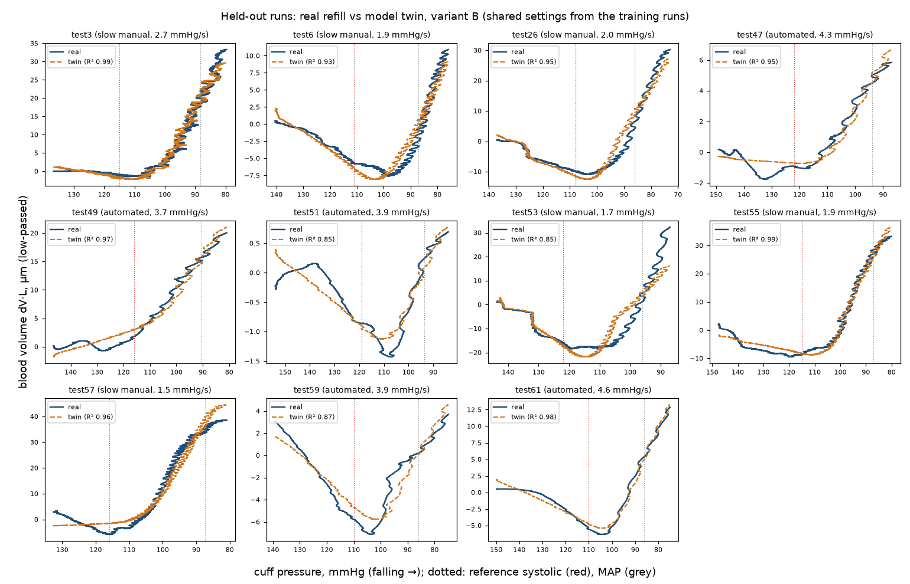
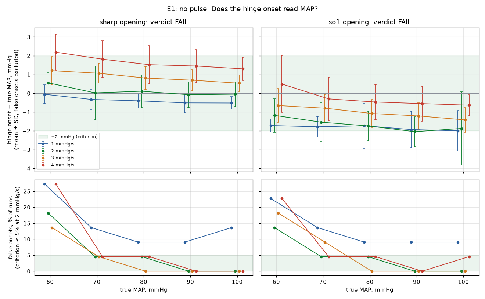
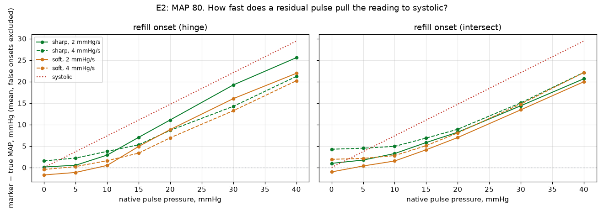

# Does return to flow still read MAP without a pulse? (simulation)

**Date:** 1 November 2026

## Summary of work done

Over the last few days I've been looking at the question we can't answer on ourselves: does return to flow still give us MAP in a patient with no pulse, like an LVAD patient? All our testing so far has been on healthy volunteers, where it lines up with systolic. Since the phantom isn't built yet, I had Claude build a simulation of the forearm under the cuff, generate non-pulsatile data, and run it through our real analysis, unchanged and kept fully separate from our dev tools. The simulation isn't told where flow returns. Blood just gets past the cuff whenever arterial pressure is above cuff pressure, so with a pulse that happens near systolic and without one it happens at MAP.

First we checked it against our own data. For each of our 22 runs with a reference BP, we made a simulated "twin" using that run's real cuff pressure and blood pressure, tuned the simulation on half the runs, and tested it on the other half (real in blue, simulated in orange):

The shapes match well, and the simulation puts the onset about where our analysis does on real runs (roughly 6 mmHg below systolic vs about 7 in the real data). It also explains why we read low: the first trickle of blood past the cuff is too small to see. It doesn't get pulse return right, though, so I'm not trusting it on that marker yet.

Before running the experiments we wrote down what a pass would be: with no pulse, at 2 mmHg/s and every MAP from 60 to 100, the reading has to be within ±2 mmHg of MAP on average, with a spread of 3 mmHg or less, and no more than 5% of runs can miss or be more than 10 mmHg off. Each condition was run 22 times, each borrowing the noise and drain of one of our real runs, so the data is as messy as ours.

Technically it failed, but usefully. When the analysis found an onset, it read MAP within about ±2 mmHg at every MAP and deflation speed (top row). The problem is that it sometimes didn't find one, mostly at low MAP (bottom row): at MAP 60, 14–18% of runs missed. Those were the runs borrowing noise or drain from our worst recordings. At low MAP the returning blood is weak enough that it can't overcome the drain before the cuff is dumped.

We also checked what a small leftover pulse does, since many LVAD patients have one:

Up to about a 10 mmHg pulse pressure, the reading stays within 3 mmHg of MAP. At 15–20 mmHg it reads 5–11 mmHg high. The HeartMate 3's artificial pulse barely matters (about 1 mmHg). The surprise was an aortic valve that only opens on some beats: even one beat in five reads as high as a full pulse (11–13 mmHg above MAP). On the plus side, none of the other markers gave a fake MAP reading without a pulse.

## What went well

When we find the onset with no pulse, it reads MAP. That's the first evidence we have for the patients we're actually building this for, even if it's simulated. Checking the simulation against our own runs first is what makes me trust it, and writing the pass criteria down beforehand kept us from calling this a win based on accuracy alone.

## What didn't go well

We failed on reliability: too many missed onsets at low MAP, with strong drains, or with noisy signals. The simulation also has gaps. It can't reproduce pulse return, it's based on healthy arms rather than LVAD patients, and we can't tell whether the artery opens sharply or gradually, which leaves about ±2 mmHg of uncertainty. One early result (a small pulse pulling the reading most of the way to systolic) also didn't hold up once we ran the full set. Same small-sample lesson as last time.

## Reflection

This is a simulation, not real evidence, and it makes me want to build the phantom sooner. The encouraging part is that the failure points at detection and protocol, not the underlying idea, which matches what volunteer testing has shown. The drain, noise and movement that caused misses here are the same problems we're already planning to fix with better cuff control and a sensor holder. The intermittent valve result worries me clinically, since nothing we have reads MAP for those patients.

## Things to note

- Don't change the real analysis yet. Try a fix for the missed onsets in the simulation first.
- Hold at the top until the trace flattens. An 8 s hold roughly tripled the misses.
- Stick with 2 mmHg/s. 1 mmHg/s missed more, and 4 mmHg/s read slightly high.
- Keep the arm still near the end of deflation. Movement right before MAP shifted the reading 1–4 mmHg.
- When the phantom is ready, test low MAP, a strong drain, and a pulse on only some beats first.
