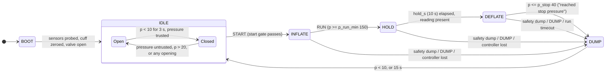

# Checks during a run

Every check the expo rig makes during a test: which state it runs in, what it looks at, and what
it does when it fails. Taken from the code as of 2026-11-23 (`firmware/expo_fw`,
`host/expotool/results.py`, `host/bench_gui.py`, `web/index.html`). Numbers are the
`config.h` defaults; `SET` can tighten some of them.

Three layers check things:

1. **The board** (`expo_fw`). It is the only layer that can act on the cuff. Its checks dump the cuff
   (valve open), refuse a command, or warn.
2. **The iPad and the bench GUI.** They show sensor state and lock the Start button, but every gate
   they show is checked again on the board.
3. **The analysis** (`results.py`, on the laptop after the run). It never touches the cuff; it
   decides the result flag.

## State machine

Valve: normally open. It is closed in INFLATE and HOLD, pulsed in DEFLATE, open in DUMP, and in IDLE
it is closed only once the cuff has read empty for 3 s. Whenever closing isn't allowed, every loop
pass forces it open. A reset, crash, power loss or watchdog timeout also opens it.

## Sensor map

| Sensor | Bus address | Mux channel | Needed to run? | If it is lost mid-run |
|---|---|---|---|---|
| TCA9548A mux | 0x70 | (main bus) | yes, indirectly | everything behind it goes; pressure on ch7 then dumps |
| MPRLS pressure | 0x18 | 7 | **yes** | **dump** after 250 ms with no good reading |
| Distal PPG MAX30101 | 0x57 | 0 | **yes** | **dump** after 500 ms with no sample |
| Distal IMU BMI270 | 0x68 | 0 | no | warning (`imu_dropout`) |
| Proximal PPG MAX30101 | 0x57 | 1 | no (`REQUIRE_PROXIMAL_BAND = false`) | warning once |
| Proximal IMU BMI270 | 0x68 | 1 | no | warning (`imu_dropout`) |

A sensor is declared **lost** after 3 consecutive I2C failures (`I2C_FAIL_LIMIT`). In IDLE the board then
looks for it again by itself (pressure every 2 s, bands every 3 s); `R` (Refresh) does it at once.

## BOOT (once, at power-up or reset)

The valve is open throughout, and the watchdog starts after bring-up.

| Check | Pass | Fail |
|---|---|---|
| Mux answers at 0x70 | `mux_ok=1` | `E,no TCA9548A at 0x70…`; no band or ch7 sensor can be found |
| PPG part ID at 0x57 (each band) | reads 0x15 and configures | `E,band X: no MAX30101 reply…` / `unexpected part id` / `configuration failed`; `ppg_ok=0` |
| IMU chip ID at 0x68 (each band) | reads 0x24, then config blob, 200 Hz, ±2 g, 500 dps, FIFO | `E,band X: no BMI270 reply…` / `init failed` / `configuration failed` / `FIFO setup failed` |
| MPRLS answers at 0x18 on ch7 | `pressure_ok=1` | `E,no MPRLS at 0x18 on mux channel 7…` |
| MPRLS integrity bit (status 0x04) | clear | `E,MPRLS memory-integrity flag set…`; START refused, valve held open |
| Zero: 50 readings after 2 s vented | at least 25 good (powered, not saturated) | `E,ZERO failed: only n of 50 readings good`; not zeroed |
| Readiness summary | `# ready: all 5 sensors` or `# ready to run: n/5` | `# NOT ready` (pressure or distal PPG missing) |
| Wi-Fi access point | `# wifi ready` | `# Wi-Fi did NOT start` (USB still works) |

## Every loop pass, in every state

| Check | Rate | Fail |
|---|---|---|
| PPG FIFO pointers and data read (each band with `ppg_ok`) | every 10 ms | 3 failures in a row → `ppg_lost` (E line + event) |
| PPG FIFO overflow | every drain | samples discarded, counter advanced, `ppg_overflow` event (the analysis marks the run incomplete) |
| IMU FIFO length and frames (each configured band) | every 10 ms | 3 failures → `imu_lost`; more than 160 frames waiting → `imu_overflow` |
| IMU silent more than 500 ms | every pass | `imu_dropout` warning, once until it resumes (`imu_resumed`). **Never dumps.** |
| MPRLS conversion: start ACK, reply, busy under 20 ms, 4-byte read | 100 Hz | 3 failures → `pressure_lost` |
| MPRLS status of each reading | 100 Hz | integrity bit sets the integrity flag (sticky until `R`); a reading counts as *good* only if powered, not saturated, and zeroed |
| Valve invariant | every pass | closing not allowed → force the pin low (open) |
| Task watchdog | 1 s | loop hung → chip resets → valve opens |
| Loop pass longer than 20 ms | every pass | `slow_loop` event (at most 1 per second) |
| Controller (Wi-Fi) heard within 2 s | every pass | `controller none lost`; consequence depends on state (below) |
| Analyser (laptop) heard within 2 s | every pass | `analyser none lost`; its dashboard address (`analyser_url`) is cleared too |
| Wi-Fi send buffer | every 500 ms (ST) | `wifi_overflow` (lines dropped), `wifi_client_closed` |

## IDLE

| Check | When | Fail |
|---|---|---|
| **Idle valve rule** (`idleValve`) | every 100 ms window | opens the valve with `EV,valve,open in IDLE: <why>` when: no zeroed sensor · integrity flag · no good reading for 250 ms · p > 20 mmHg. Closes again (`closed in IDLE`) after p < 10 for 3 s |
| Over-pressure outside a run: p > p_max (280) | every pass | `warning`, valve opened, said once |
| Pressure sensor missing | every 2 s | probe 0x18 (and 0x70 if the mux was lost); when it answers: bring up (everything if the mux was lost), `pressure_found`, re-zero |
| Band missing (PPG, or the IMU of a working band) | every 3 s, not while streaming on USB | one silent address probe per missing part; when it answers: bring up, LED level (PPG), `band_found` event, stream gap |
| **START gate** (board) | on START | refused with `E,START refused: <why>` + `start_refused` event, first failing of: no pressure sensor · integrity flag · not zeroed · no reading in 250 ms · p ≥ 10 (cuff not vented) · distal PPG not OK |
| Start lock (iPad) | live | the button stays locked with one reason: not connected · no control · pressure bit 0 · not zeroed · p ≥ 10 · distal PPG bit 0. Not a lock: a countdown asks for 6 s of resting pulse first |
| Command needs IDLE | ZERO, DARK, R, LEVEL, SCAN, PPG, VALVE TEST, TEST HANG, AMP, SET (except p_run_min), RADIO | `E,<cmd> refused: state is …`. ZERO, DARK, R, LEVEL, SCAN, PPG, VALVE TEST and TEST HANG also refuse while the USB stream is on (the bench GUI pauses the stream for ZERO, R and VALVE TEST only) |
| Command needs control (Wi-Fi) | START, RUN, SET, ZERO, BLINK, R | `refused: client n does not have control`. Bench commands are refused over Wi-Fi altogether |
| **Refresh (`R`)** | on demand | re-probes every sensor as at boot, then sets the LED level per band (below) |
| LED level (`R`, `LEVEL`) | on demand | aims each LED at 50 % of full scale (±15 %), up to 5 steps between 0.8 and 25.4 mA. Warns `light still dim at the highest LED current: is the band on the skin?` (under 10 %) or `light still saturated at the lowest LED current` |

## INFLATE and HOLD (valve closed)

The run-wide checks are made on every loop pass (all three active states). Any failure **dumps the cuff**:

| Check | Limit | Dump reason |
|---|---|---|
| Pressure sensor lost, or no good reading | 250 ms | `pressure dropout` |
| Integrity flag | any | `pressure sensor integrity flag` |
| Over-pressure | p > p_max (280) | `overpressure` |
| Distal PPG lost, or no sample | 500 ms | `ppg dropout D` |
| Proximal PPG lost, or no sample | 500 ms | **no dump**: `warning` once (it was working at START) |
| IMU (either band) | 500 ms | **no dump**: `imu_dropout` |

Also in INFLATE and HOLD:

| Check | Limit | Fail |
|---|---|---|
| Valve closed too long with pressure | p > 20 for more than hold_timeout_s (120 s) since START | dump `hold timeout` |
| Controller lost, on a run started over Wi-Fi | 2 s silence or disconnect | dump `controller lost` |
| RUN gate (INFLATE) | p ≥ p_run_min (150) | `E,RUN refused: p=… below p_run_min=…` + `run_refused` |
| HOLD → DEFLATE | hold_s (10 s) elapsed **and** a reading that window | waits for a reading |

## DEFLATE (valve pulsed to bleed 2 mmHg/s)

The run-wide checks from INFLATE and HOLD apply here too, plus:

| Check | Limit | Result |
|---|---|---|
| No good reading this 100 ms window | — | valve fully open for that window (vents rather than guesses); the 250 ms dropout dumps if it persists |
| Reached stop pressure | p ≤ p_stop (40) | `run_summary` (mean rate, rate RMS error) and dump `reached stop pressure`: **the only ending that gets a pressure result** |
| Run timeout | t > 2 × (p_start − p_stop) / rate + 15 s | dump `run timeout` |
| Controller lost | 2 s | **no dump**: warning, the run finishes on the board's limits |

## DUMP (valve open)

| Check | Limit | Result |
|---|---|---|
| Cuff vented | p < 10 | → IDLE |
| Gave up waiting | 15 s | → IDLE with `warning: left DUMP without a vented reading` |

Back in IDLE the valve stays open and closes after 3 s of p < 10 (the idle valve rule).

## After the run: analysis (`results.py`)

A run is the stream from START (INFLATE) to the vent (IDLE), plus 15 s of pre-roll from before
START. It gets a number when it reaches DEFLATE; a run dumped before DEFLATE isn't counted.

| Check | Limit | Flag |
|---|---|---|
| How the cuff was dumped | anything but `reached stop pressure` | `stopped` (DUMP pressed) or `safety_stop` (any board dump); no pressure |
| Enough data to analyse | at least 64 samples and 10 good pressure readings | `incomplete` |
| Pressure glitches | a reading more than 3 mmHg off the median of the 11 around it is dropped; then a 0.5 s centred mean | dropping more than 25 % → `incomplete` |
| Holes in the stream | any `stream_gap`, `ppg_overflow`, `wifi_overflow`, link lost, missing S sample index, or no IDLE within 20 s after the dump | `incomplete` |
| Light on a rail | IR or red above 97 % or below 2 % of full scale for more than 1 % of the deflation | `incomplete` |
| Arm moved: PPG | the validated motion detector, from DEFLATE to 5 s after the onset | `arm_moved` |
| Arm moved: IMU | gyro over 20 deg/s, either band, same window (**skipped with no IMU fitted**) | `arm_moved` |
| Flow fully stopped | pulse in the hold / uncuffed pulse ≤ 0.5. **Needs 4 s of uncuffed pre-roll; skipped otherwise** | `pulse_present` |
| Refill onset found | hinge onset of distal blood volume | `no_onset` if none: no pressure |

When several flags apply, the result shows the first of `incomplete`, `arm_moved`, `pulse_present`,
and logs all of them. The reported pressure is the cuff pressure at the hinge onset.

## Bench GUI (`bench_gui.py`)

It changes nothing on the board by itself, except sending `R` once when the USB link comes up. It shows:

| Part | Shown as |
|---|---|
| Gauge | NOT FOUND · integrity FAIL · not zeroed · OK (from INFO, ST and each S line's status byte) |
| Valve | closed / open / n % open: the **commanded** duty from the C line, not a measurement |
| Mux | OK / NOT FOUND (from INFO) |
| PPG D, PPG P, IMU D, IMU P | OK / not found (ST sensor digits and INFO) |

## What the audit found

**Removed or fixed as dead or stale:**
- the `LOCAL` tuple in `usbhub.py`, which nothing read;
- `expo_fw.ino` still said "not yet run on hardware";
- `config.h` named the WROOM as the board and put the MPRLS on the main bus;
- `session.h` said the valve is open in IDLE;
- `bench_gui.py` said no sensor is ever retried (pressure now is);
- `IMU_GYR_RANGE_DPS` was reported in INFO but not used to configure the gyro; it is now asserted
  to match.

**Left in, on purpose:**
- `REQUIRE_PROXIMAL_BAND` (false): the switch for when a model uses the proximal band;
- the WROOM pin branch in `config.h`: a second board the same firmware builds for;
- `firmware/xiao_bus_test`: the bus bring-up sketch;
- `IGNORE_PRESSURE_INTEGRITY` (true since 2026-11-24): a bench override for a faulty MPRLS. While on,
  the integrity flag only warns at START instead of refusing it and dumping the cuff.

**Gaps worth knowing while testing:**
- **Pulse check skipped:** `pulse_present` is skipped when there is less than 4 s of uncuffed
  pre-roll, as in runs 9 and 11. The iPad now counts down 6 s of resting pulse before Start (advice, not a lock); the bench GUI doesn't.
- **No light-level check at START:** a band that is off the skin or saturated starts anyway. The
  dim/saturated warning comes only from Refresh, and the analysis rail check only after the run.
- **Arm movement without the IMU:** with no IMU fitted, `arm_moved` relies on the PPG motion detector
  alone. The GUI shows an unfitted IMU in red as "not found".
- **Mux has no check of its own during a run:** losing the mux shows up as a pressure dropout (the
  MPRLS is behind it on ch7), which dumps the cuff.
