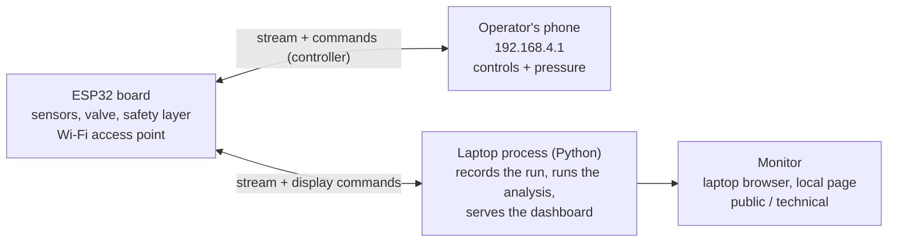

# Expo demo: design

**Status:** ideation draft · 2026-11-18. Nothing in this document is built yet unless it says
so. How to flash, join the network and test the link is in [`README.md`](README.md); this file
is what the demo does and what each screen shows.
**Scope:** the cuff demo at the exposition: the operator's phone, the monitor dashboard and
the laptop process between them. It builds on the link simulator and the paused `expo_fw`
(README), which are forked from the IRB firmware ([`irb/DESIGN.md`](../irb/DESIGN.md)).

---

## 1. What the demo does

Visitors at the booth have their blood pressure measured by return to flow. A cuff on the
upper arm is pumped up, held, and let down under the board's control at 2 mmHg/s. The forearm
light sensor sees when blood comes back past the cuff, and the cuff pressure at that moment is
the result.

- **Who wears the cuff:** visitors (anyone who passes the verbal screen in §4.1) and the team.
- **Who runs it:** the operator, from their own phone. No other device controls the cuff.
- **Who watches:** judges and the public, on a monitor driven by the laptop. It has a
  **public** mode (what is happening, in plain language) and a **technical** mode (signal
  pipeline, cuff controller, peripherals).
- **What the number means.** Visitors have a pulse, so return of flow happens near their
  **systolic** pressure. In a pulseless LVAD patient, the end user, the same point is **MAP**
  (SPEC §1; `docs/notebook/2026-11-01-non-pulsatile-simulation.md`). So the result is called
  the **return-of-flow pressure**, never MAP. There is no reference cuff at the booth: the
  only reading is the prototype's.
- **Not a medical device,** and not part of the IRB protocol. Nothing that identifies a
  visitor is recorded (§7.5).

---

## 2. Decisions (settled 2026-11-18)

| Question | Decision |
|---|---|
| Who controls the cuff | the operator's phone only |
| Phone content | controls + pressure, plus a one-line result; no plots |
| Dashboard | public and technical modes; full swap between them |
| Who switches the mode | the phone **or** a laptop key / clicker; last press wins |
| Mode after a new Start | back to public |
| Technical layout | one dense screen for now; to be refined |
| Result | yes, after every complete run, labelled "return-of-flow pressure" |
| Where it is computed | a laptop Python process, using `host/mapquest` unchanged |
| When | after the cuff vents; no live estimate |
| Headline marker | refill onset (hinge, D43) |
| Other markers | intersect and pulse return in technical mode only; steep refill hidden |
| Weak result | number + caution flag with a plain reason; no onset → "No clear reading" |
| Marker disagreement | not used as a flag |
| Automatic vent, public view | calm "safety stop", framed as a feature; red only on the phone |
| After an automatic vent | the phone must acknowledge before the next Start |
| Inflation target | fixed: **160 mmHg**, Run unlocks at **150** |
| Hold | **10 s** (the firmware default) |
| Pulse still present at target | phone warns; pump higher up to **target + 30 = 190** |
| Cuff | one adult cuff for everyone |
| Safety screening | verbal only; no checklist on the phone |
| Results on the monitor | shown, anonymous (run number only) |
| What is kept | anonymous results only; no raw visitor signals |

---

## 3. System



- **The board is the hub.** The phone and the laptop both join the board's Wi-Fi (README,
  Network). They never talk to each other directly.
- **Change from the README:** the monitor no longer opens `192.168.4.1/?view`. The laptop
  process (growing out of `host/expo_receiver.py`) is the laptop's only connection to the
  board, and it serves the dashboard to the laptop's own browser. That keeps the board at two
  clients (phone, laptop) of its four.
- **Control rules are unchanged** (README, Control rules): one controller, DUMP open to every
  device, the controller-lost dump during INFLATE and HOLD.

### 3.1 Display commands (built 2026-11-18, not flashed)

The mode switch and the result have to reach every screen, so they go through the board. They
form a new class of command:

- **open to every connected device** (the laptop is not the controller);
- **never touch cuff state**: no valve, no settings, no session state;
- the board keeps the latest value and repeats it (mode and analyser in the `ST` status line,
  the latest result in `INFO`), so a screen that reconnects comes back in step.

| Command | Sent by | Effect |
|---|---|---|
| `VIEW PUBLIC\|TECHNICAL` | phone or laptop | every screen shows the new mode; reset to public when START is accepted |
| `RESULT <run> <mmHg\|-> <flag>` | laptop | the phone shows its one-line result. Flags: `pending ok no_onset arm_moved pulse_present incomplete safety_stop stopped`; the reason text stays in the laptop's file (board command lines are 63 characters) |
| `ANALYSER` | laptop | marks the results process, for the phone's Analyser light |
| notice (e.g. pulse still present) | laptop | **not built**: waits for the live pulse detector (§9.3) |

Both sketches carry the same code (a test keeps them identical). Formats: README, Control rules.

---

## 4. A visitor's run

### 4.1 Before the run

- **Verbal screen** (SPEC §8): no anticoagulants, vascular disease or fragile skin; tell
  the operator at once about pain, numbness or tingling. The phone has no checklist for this.
- One adult cuff on the upper arm; the light-sensor bands on the forearm and upper arm.

### 4.2 Profile

| Step | Setting | Time |
|---|---|---|
| Pump by hand with the bulb | to **160 mmHg**; Run unlocks at **150** | ~10 s (assumed) |
| Hold | **10 s** | 10 s |
| Deflate | board PI loop, **2 mmHg/s**, from the pressure at the end of the hold | 60 s from 160 |
| Vent | at **40 mmHg** (`p_stop`) | |
| **Total cuff time** | | **~80 s** (~95 s if pumped to 190) |

All inside the 120 s hold timeout (inflation + hold) and SPEC §8's 2-minute occlusion limit.
The target, Run threshold, hold and cap are settings in the phone's drawer; the firmware takes
`SET` in IDLE, so none of them needs a reflash.

**Who 160 works for.** By the IRB rule (target = occlusion point + 30, `irb/DESIGN.md` §2.1),
a 160 target suits visitors whose pulse stops by about 130 mmHg. Above that, the pulse check
(§4.3) asks for more pressure.

### 4.3 Flow

| # | Operator | Phone | Monitor |
|---|---|---|---|
| 0 | | Analyser light on, sensors green, cuff zeroed | public idle screen |
| 1 | Screen verbally, fit the cuff and bands | | "getting ready" |
| 2 | **Start** | "Pump to 160" | back to public mode; phase: cuff squeezing |
| 3 | Pump | readout green at 150; amber **"pulse still present, pump higher (max 190)"** if the pulse doesn't stop | live pressure, arm illustration |
| 4 | **Run** | "Deflation starts in N s" | phase: holding |
| 5 | | rate vs −2.0 mmHg/s | phase: letting the cuff down; blood volume live |
| 6 | | "Venting", then "Analysing…" | "Analysing…" |
| 7 | | one line: "Return of flow: X mmHg" (+ flag) | result card, anonymous run number |
| 8 | **Next visitor** | | back to idle screen |

DUMP is available at every step.

---

## 5. Phone

Controls and pressure, built for one hand while the other pumps. Starts from today's
`web/index.html`, minus the plots and "Zero volume" (Blink and the event log move to the
drawer).

```
┌─────────────────────────────────────┐
│ ● Live  You control  Analyser ●     │
│ Monitor: [Public | Technical]       │
├─────────────────────────────────────┤
│            DEFLATING                │
│              142 mmHg               │
│     −2.0 mmHg/s · cuff closed 34 s  │
│ Return of flow: 118 mmHg (last run) │
├─────────────────────────────────────┤
│ ● Cuff ● Dist PPG ● Prox PPG ● IMUs │
│  [  START  ]        [   RUN   ]     │
│ [           D U M P            ]    │
│                     ⚙ settings      │
└─────────────────────────────────────┘
```

| Component | Behaviour |
|---|---|
| Status strip | link live / lost, "You control", **Analyser** light (is the laptop process connected?) |
| Mode switch | display only, far from DUMP; always shows the current mode, works mid-run |
| State banner | Ready · Inflating · Holding (countdown) · Deflating (rate) · Venting · Analysing |
| Pressure readout | the largest element; "pump to 160", green at 150, red above the 190 cap |
| Occlusion timer | how long the cuff has been closed, against the 120 s hold timeout |
| Result line | "Return of flow: X mmHg" with its flag, after each complete run |
| Sensor lights | cuff, both PPGs, both IMUs |
| Start / Run | enabled only where the firmware accepts them; Start shows **one** reason when blocked (§8.1) |
| DUMP | always enabled; says "open the bulb release screw" if it can't reach the board |
| Fault banner | red, with reason and what to do; blocks Start until tapped (§8.2) |
| Next visitor | resets the monitor to its idle screen |
| Settings drawer | target, Run threshold, hold, cap, Zero cuff, Blink, link diagnostics, event log |

Keep the screen awake during a run: a sleeping phone stops pinging, and that vents the cuff
(README, Control rules).

---

## 6. Monitor dashboard

### 6.1 Shared frame

- A run stepper: Idle → Inflate → Hold → Deflate → Result, with the run number.
- A small mode label in a corner, so a presenter knows which mode is up.
- "Reconnecting" and "Analyser offline" notices.

### 6.2 Switching modes

- **Phone:** the mode switch (§5). **Laptop:** one key (e.g. T), and the keys a presentation
  clicker sends (Page Up / Page Down / arrows). Both go through the board (§3.1); the last press
  wins.
- **Full swap**, with a short crossfade. Both modes draw from the same live data and history,
  so switching mid-run shows the run so far at once.
- **Back to public** whenever a new run starts.

### 6.3 Public mode

| Component | Content |
|---|---|
| Idle screen | what MAPQuest is; why LVAD patients have no pulse; "next up" |
| Live pressure | big number or gauge |
| Arm illustration | the forearm fills with blood, driven by the live blood-volume signal |
| Phase captions | e.g. "Blood flow stopped", "Releasing slowly", "Blood is back" |
| Pressure trace | with the return-of-flow moment marked |
| Result card | "Return-of-flow pressure: X mmHg", run number, amber caution tag when flagged, one line on how this point is MAP in a pulseless patient |
| Results board (optional) | today's anonymous results |

### 6.4 Technical mode (one dense screen, first pass)

```
┌───────────────────────────────────────────┬───────────────────────┐
│ Signal pipeline (largest zone)            │ Cuff controller       │
│ raw IR/red → ΔOD → blood volume →         │ state machine, lit    │
│ low-pass → dV/dt vs μ0+3σ0 → onset        │ Pref ramp vs actual   │
│ (stacked, one time axis; hinge fit drawn, │ rate, valve duty      │
│  intersect + pulse return as small marks) ├───────────────────────┤
│                                           │ Safety margins        │
│                                           │ 280 · 120 s · dropouts│
├──────────────────────────┬────────────────┴───────────────────────┤
│ Hardware diagram         │ Link health + event log                │
│ ESP32, mux, bands, valve │ rates, latency, gaps, who controls     │
└──────────────────────────┴────────────────────────────────────────┘
```

- **During the run** the raw, ΔOD and blood-volume panels draw live (they need no data from
  later in the run). The low-pass, derivative and onset panels fill in after the vent, because
  the validated filters are zero-phase and need the whole run (SPEC §5.1).
- **The result card** sits over the pipeline zone at the end of a run.
- **"How well does this work?"** A small panel with the bench evidence, labelled as bench data:
  refill onset (hinge) read −6.2 ± 7.9 mmHg against systolic on 8 slow manual runs (D47).
- Steep refill is not shown anywhere.

---

## 7. The result

### 7.1 Where and when

The laptop process holds the run in memory and runs `host/mapquest` after the cuff vents. About
1–2 minutes of 100 Hz data takes well under a second. The phone and monitor show "Analysing…"
in between. Only a run that reaches `p_stop` gets a result. An automatic vent gets the safety
card instead (§8.2).

### 7.2 Windows from the board, not from the pressure trace

On the bench, `mapquest/cuff.py` guesses the hold and deflation windows from the pressure
trace. On some runs that put the onset 12–36 mmHg away from the hand-checked answer (D43).
The expo board announces each state change (`EV,state`), so the laptop knows them exactly:

| Window | From |
|---|---|
| Reference (occlusion) | the end of HOLD |
| Deflation start | HOLD → DEFLATE |
| Search end (D48) | the dump at `p_stop` |

This is a small adapter in front of `derive()`; the analysis itself stays unchanged.

### 7.3 Headline marker

**Refill onset (hinge)** (D43), the analysis default. It handles the soft refill starts that
slow deflation produces, and it measures blood volume coming back, the same physics as the
LVAD story. Intersect and pulse return are computed and shown in technical mode only.

### 7.4 Confidence flags

| Flag | Source | Card |
|---|---|---|
| No clear reading | no onset found | no number; reason; offer a re-run |
| Arm moved | IMU (`M` lines) during deflation | number + "arm moved" |
| Pulse never fully stopped | pulsatility over the hold (`pulsatility_rms`) | number + "flow may not have fully stopped" |
| Signal incomplete | gaps in a sample counter (the board drops whole lines when its ring buffer fills), or counts near the rails | number + "signal incomplete" |

### 7.5 What is kept

One anonymous row per run: run number, time, result, flag and the flag's reason. Raw signals
are discarded once the visitor leaves.

---

## 8. Failure states

### 8.1 Start blocked

The phone greys Start out and shows **one** reason with its fix. The public monitor stays on
"getting ready". Technical mode lights the failing part amber or red.

| Firmware reason (`START refused`) | Phone says |
|---|---|
| cuff not vented | wait for the cuff to empty, or open the release screw |
| pressure not zeroed | Zero cuff (highlighted) |
| a PPG band is not OK | check the band cable; re-check |
| no pressure sensor / integrity flag | pressure sensor fault: can't run |
| (phone) fault not acknowledged | tap the banner first |
| (phone) not in control | Take control |
| *(new)* light level dim, saturated or off skin | reposition the sensor |

### 8.2 Automatic vent mid-run

- **Phone:** a red banner with the reason and what to do. Start stays blocked until it is
  tapped, a moment to ask how the visitor's arm feels. A deliberate DUMP needs no tap.
- **Public monitor:** **"Safety stop: the cuff released itself"** and one plain line; no
  result card.
- **Technical:** the safety panel highlights the limit that tripped; the timeline marks it.

| Dump reason | Public line (draft) |
|---|---|
| overpressure (> 280 mmHg) | "Pressure reached the safety ceiling" |
| hold timeout (closed > 120 s) | "Cuff was up long enough, released for comfort" |
| run timeout | "Release took longer than expected" |
| pressure dropout / integrity flag | "Pressure sensor stopped reporting" |
| PPG dropout (either band) | "Lost the light sensor" |
| controller lost (INFLATE, HOLD) | "Operator's phone disconnected" |
| user (DUMP pressed) | "Run stopped" (neutral, not a safety stop) |

### 8.3 Warnings during a run (cuff stays up)

| Warning | Phone | Monitor |
|---|---|---|
| Pulse still present (INFLATE / HOLD) | amber "pump higher (max 190)" | public: nothing; technical: pulse strength vs the "stopped" level |
| Arm moving | "ask them to keep still" | technical: motion trace |
| IMU dropout | | technical only (the firmware never vents for it) |
| Phone lost during DEFLATE | "run continuing on the board, reconnecting…"; reclaims control | |

### 8.4 Link and board

| Failure | Handling |
|---|---|
| Phone loses the link while idle | reconnect overlay; DUMP says "open the bulb release screw" |
| Laptop process loses the link | "Reconnecting"; mid-run, the result gets "signal incomplete", or none if the gap covers the onset; phone's Analyser light goes off |
| Laptop process not running | the cuff still runs safely, but no result: the phone shows it before Start |
| Board restarts (watchdog, power) | the valve opens (normally open); both screens show "board restarted, cuff vented"; Zero before Start |
| Phone screen sleeps | keep-awake setting; otherwise it counts as a lost controller |

---

## 9. New pieces this needs

1. **Display commands** on the board (§3.1): **built** in both sketches, not flashed.
2. **The laptop process** (`host/expo_results.py`): records the run in memory, builds windows
   from board events (§7.2), runs `host/mapquest`, keeps the anonymous results: **built**,
   tested on the stand-in only. It does **not serve the dashboard yet**.
3. **Live "pulse still present" detector** during INFLATE and HOLD. `mapquest/pulse_return.py`
   only runs after the fact. Not built.
4. **Confidence checks** (§7.4): **built**; the IMU limit (20 °/s) and the occluded-pulse
   ratio (50 %) are provisional until team dry runs.
5. **Light-level check before Start** (§8.1). Not built.
6. **The dashboard** (§6): not built. **The phone page** (§5): built, except "Next visitor"
   (it resets the dashboard, which does not exist yet) and the pump-higher hint (needs 3).

---

## 10. Risks and checks before the expo

- **The expo cycle has never run on an arm.** Every bench run so far was a hand-bled or
  automated-monitor cycle. Team dry runs on the board-controlled 2 mmHg/s ramp should confirm
  that the hinge finds the onset.
- **A 10 s hold is short for the hinge.** The notebook got unambiguous onsets with 20–30 s
  holds, and the simulation tripled its misses at 8 s. If dry runs give many "No clear
  reading" results, lengthen the hold first (a drawer setting).
- **One adult cuff and a 160 target.** Large arms (over ~34 cm, AHA) need more pressure to
  occlude and can over-read. These visitors are the likeliest to hit the 190 cap or get
  flagged results.
- **Dead-client stall** (README): a device leaving the network used to stall the stream to
  every device for ~1–2 s. Fixed in source 2026-11-18 (one sender per device); not yet
  flashed or re-tested (README checklist row 13).
- **Radio noise on the real sensors** and the valve with Wi-Fi on (README, Owed).

---

## 11. Open

1. **Public mode's visual design** and the idle screen's content.
2. **Technical layout refinements** beyond the first pass in §6.4.
3. ~~Exact display command names and line formats~~ (§3.1): settled 2026-11-18.
4. **Should the 190 cap also be a hard limit?** `SET p_max` can tighten the board's
   over-pressure vent (never loosen it). Today 190 is only a red readout on the phone.
5. **Approval for visitor demos.** The expo is outside the IRB protocol; confirm with the
   advisor that demonstrating the cuff on members of the public is allowed.
