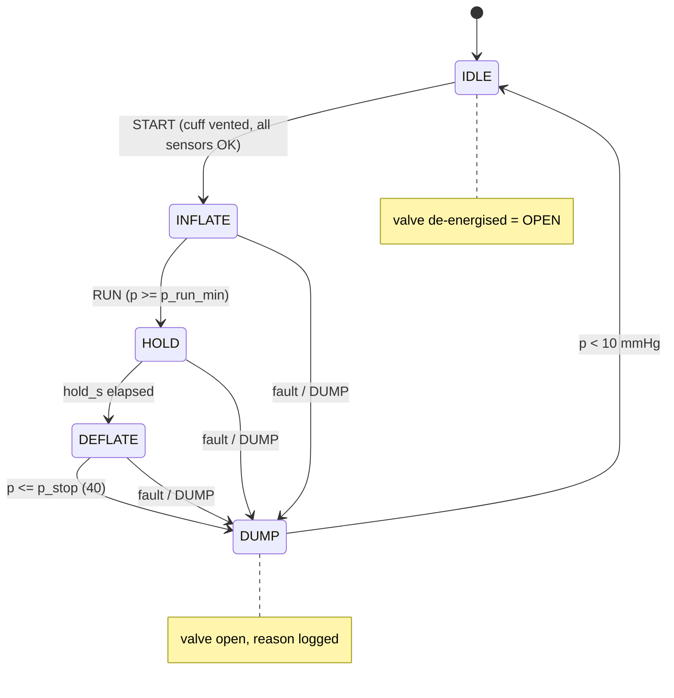
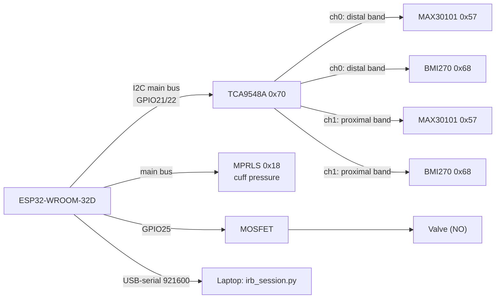

# IRB session tool: design

**Status:** draft for review · 2026-11-09. Firmware 0.2.1 was flashed to a bare board on
2026-11-10; only boot and the watchdog are verified on hardware (see `irb/README.md`).
**Scope:** the firmware and laptop tool used for IRB human-subject sessions. It lives in
`irb/` and shares no code paths with `firmware/mapquest_ppg/` or `host/hr_monitor.py`, so
the cuff tooling used so far keeps working unchanged.

---

## 1. What it does

One session, one subject, several runs. In each run, the operator applies the cuff and two
sensor bands, presses **Start**, inflates the cuff with the bulb, and presses **Run**. The
board then holds, deflates under its own control at 2 mmHg/s, dumps the cuff at 40 mmHg and
stops recording on its own. A **DUMP** button empties the cuff at any time.

Everything the sensors produce is recorded:

| Sensor | Where | Shown live | Recorded |
|---|---|---|---|
| MAX30101 PPG, **distal** | forearm, below the cuff | relative blood volume | yes |
| MAX30101 PPG, **proximal** | upper arm, above the cuff (shoulder side) | no, just a status light | yes |
| BMI270 IMU, distal | on the distal PPG band | acceleration | yes |
| BMI270 IMU, proximal | on the proximal PPG band | acceleration | yes |
| MPRLS cuff pressure | teed into the cuff hose | large readout + trace | yes |

The proximal PPG is the reference channel for the finished dual-sensor device. It isn't
analysed live. The goal is to collect it cleanly, time-aligned with everything else.

**Reference BP, two kinds:**
1. **During the run: Doppler.** A Doppler probe distal to the cuff. A phone films the
   Doppler and this tool's screen in one frame, and the cuff pressure at return of flow is
   read off the video later with OpenCV (the D38 approach). The screen therefore has a
   large pressure readout and a session clock.
2. **After the run: standard cuff.** An automated BP monitor reading, typed in after the
   run.

---

## 2. Session flow

The whiteboard plan, mapped onto what the operator does and what the system does:

| # | Operator | Tool / firmware |
|---|---|---|
| 0 | Connect board (Refresh / Connect) | Board zeroes the pressure sensor with the valve open, reports every sensor's status |
| 0b | Enter subject info, tune LEDs, check sensor lights | Auto-tune sets both PPGs' LED currents; **Start** is disabled until every required sensor is OK |
| 1 | Apply cuff | |
| 2 | Apply sensor bands | Live distal blood volume and acceleration confirm contact |
| 3 | **Start** | Recording begins; valve closes (state `INFLATE`) |
| 4 | Inflate with the bulb, watching the Doppler. Press **O** when its flow signal disappears, then keep pumping to the target shown | Pressure readout and trace. On **O**: target = that pressure + 30, Run minimum = that pressure + 20 (§2.1). Over-pressure and hold timeout are armed |
| 5 | **Run** (enabled once pressure ≥ the Run minimum) | `HOLD` for the hold time (default **10 s**, adjustable) |
| 6 | Watch the Doppler; optionally press **D** at return of flow | `DEFLATE`: the PI loop tracks a 2 mmHg/s ramp. At 40 mmHg: `DUMP` |
| 7 | | Records a short tail after the dump (default 10 s), then stops recording on its own |
| 7b | Enter the standard-cuff reading; Save run | Files renamed with the run ID; the ID steps on |
| 8–9 | Remove sensors, remove cuff | |

Steps 5–7 are the whiteboard's "auto-wait": nothing to press between Run and the end of
recording, except DUMP if needed.



The valve is **normally open**: every state except `INFLATE`, `HOLD` and `DEFLATE` leaves it
de-energised, so the cuff vents.

### 2.1 Inflation target: per subject, not a fixed 160

**Why not a fixed 160 mmHg.**
- **The pressure needed to occlude the brachial artery varies between people.** It rises
  with arm circumference and with systolic pressure, and it falls as the cuff gets wider.
  In a 249-person upper-arm study (Jessee et al., *Sports Medicine* 2016), arm circumference
  was the strongest single predictor for every cuff width tested. The fitted 12 cm cuff
  model was about 1.4 mmHg more per cm of arm circumference and 0.7 mmHg per mmHg of
  systolic, plus smaller arm-length, diastolic and sex terms.
- **A fixed 160 fails in both directions.** For a large arm with a high systolic, 160 may
  never fully occlude, so the run starts with flow already getting through. For a slim arm
  with a systolic of 100, 160 is 60 mmHg more than needed. That means extra discomfort and
  30 s more occlusion at 2 mmHg/s.
- **For higher-BMI subjects, the fix is the right cuff size,** not a lower pressure. An
  undersized cuff overestimates pressure and needs more inflation to occlude. The AHA
  sizes cuffs by arm circumference: 22–26 cm small adult, 27–34 adult, 35–44 large adult,
  45–52 adult thigh.

**What the tool does.** The standard clinical rule is to find the pressure at which the
pulse disappears and inflate 20–30 mmHg past it (AHA, using palpation). Here the Doppler is
already on the arm and gives that point directly:

1. **Before run 1:** take a standard-cuff reading after 5 min of rest. The first target is
   **systolic + 30**, and the first Run minimum is **systolic + 20**.
2. **During each inflation:** when the Doppler's flow signal disappears, the operator presses
   **O**. The tool records that pressure (`p_occ`) and moves the target to **`p_occ` + 30**
   and the Run minimum to **`p_occ` + 20**. It sends the Run minimum to the board
   (`SET p_run_min`). `p_occ` is saved in the run's events. It's a second Doppler
   measurement of systolic, taken on the way up.
3. **Arm circumference and cuff size are recorded.** The tool warns if the cuff size
   doesn't match the arm circumference band above.

The 280 mmHg over-pressure dump stays the hard ceiling in every case.

---

## 3. Hardware

### 3.1 Parts

| Part | Role | Address / pin |
|---|---|---|
| ESP32-WROOM-32D dev board ("ESP32 Dev Module") | MCU, USB-serial to laptop | SDA GPIO21, SCL GPIO22 |
| TCA9548A I2C mux | isolates the two identical bands | 0x70 on the main bus |
| 2× SparkFun MAX30101 (SEN-16474) | PPG, red 660 nm + IR 880 nm | 0x57, one per mux channel |
| 2× BMI270 breakout | 6-axis IMU on each band | 0x68, one per mux channel |
| Adafruit MPRLS (3965), 0–25 psi abs | cuff pressure: control **and** recording | 0x18 on the **main bus** |
| Olimex AIR-E-VALVE-3V, normally open, ~45 Ω | deflation valve | GPIO25 → MOSFET gate (220 Ω series, 10 kΩ pull-down) |
| Sphygmomanometer cuff + bulb, tee | inflation by hand | |

### 3.2 Bus layout

Wiring diagram, pin by pin: [`docs/wiring.svg`](docs/wiring.svg).



- **Each band is one module:** a MAX30101 and a BMI270 on one cable to one mux channel. The
  two bands are identical and interchangeable. The mux channel says which is which, and
  the board reports it at connect.
- **The MPRLS is not behind the mux.** The PID loop depends on it every 100 ms, and keeping
  it on the main bus means a mux or band fault can't take it away. The TCA9548A passes
  main-bus traffic to 0x18 regardless of which channel is selected.

### 3.3 Hardware checks before the first session

- **Flyback diode across the valve coil.** Without one, each PWM turn-off spikes the rail.
- **Valve supply.** About 67 mA at 3 V, switched every 100 ms. It shares the 3V3 rail with
  the sensors only if a scope shows no dip on the I2C lines. Otherwise power it separately.
- **Gate pull-down present.** This is what keeps the valve open while the ESP32 is in reset.
- **Bulb release screw stays in the line.** It's a mechanical dump that needs no
  electronics, and the operator's first fallback.
- **MPRLS span check** against a reference gauge at about 50, 100, 150 and 200 mmHg. It has
  never been verified (D41) and it now drives safety limits as well as the data.
- **Band cable length.** The proximal band runs to the upper arm. If the I2C error count is
  not zero at 400 kHz, drop to 100 kHz (see §4.2 for the time budget).

---

## 4. Firmware (`irb/firmware/irb_fw/`)

New sketch for the WROOM. It combines three existing pieces of code:
- the **PI valve control** from `valve_code/cuff_deflation_test.ino` (the reference
  implementation, currently on a separate MCU);
- the **non-blocking MPRLS read** and **inline MAX30101 driver** from
  `firmware/mapquest_ppg/`;
- a **BMI270** driver (SparkFun BMI270 Arduino Library; the chip needs an 8 KB config blob
  loaded at start-up, which the library handles).

### 4.1 Valve control (from the reference implementation)

- **Time-proportioned on/off valve.** Every 100 ms window it opens for `duty × window`, and a
  one-shot `esp_timer` closes it. Openings shorter than the minimum pulse (5 ms) carry over
  to the next window.
- **PI tracking a pressure ramp,** `Pref(t) = P_start − rate·t`, not the raw derivative. The
  error is computed on the window-averaged pressure. Integration is conditional
  (anti-windup).
- **Defaults** (from the reference code, already tuned for this cuff and valve): rate
  2.0 mmHg/s, Kp 0.08, Ki 0.04, Kd 0, starting duty 4 %, window 100 ms, minimum pulse 5 ms. Gains can be set over serial in `IDLE` only.
  Live gain changes mid-run belong to the tuner, not the IRB tool.
- **Logged every window:** state, pressure, Pref, measured rate (1 s least-squares slope),
  duty.

### 4.2 Sensor scheduling

One cooperative loop, nothing blocking:

| Task | Rate | Notes |
|---|---|---|
| MPRLS | 100 Hz | start conversion → poll busy → read (existing `servicePressure`) |
| Distal MAX30101 FIFO | drain whenever ≥1 sample | 100 Hz output, 32-sample FIFO = 320 ms of slack |
| Proximal MAX30101 FIFO | same | |
| BMI270 × 2 | 50 Hz each | data registers, ODR 50 Hz, ±4 g, ±500 dps |
| Control window | 10 Hz | PI + valve, also writes the `C` line |
| Safety checks | every pass | §4.3 |
| Serial commands | every pass | |

- The firmware remembers the selected mux channel and only writes to the mux when the
  channel changes.
- **I2C time per 10 ms** is roughly 80 bytes, so about 2 ms at 400 kHz and about 7 ms at
  100 kHz. 100 kHz still fits but leaves little slack.
- **Task watchdog, 1 s.** If the loop hangs, the chip resets, GPIO25 floats, the pull-down
  holds the MOSFET off, and the valve opens. Without it, a hang during `HOLD` would hold
  the cuff up.

### 4.3 Safety layer

Hard limits are compiled into `config.h`. `SET` can make a limit **stricter**, never
looser.

| Condition | Threshold (default) | Applies in | Action |
|---|---|---|---|
| Manual DUMP (GUI button, Esc, window close) | | any | dump, reason `user` |
| Over-pressure | > 280 mmHg | any | dump, `overpressure` |
| Hold timeout | valve closed and p > 20 mmHg for > 120 s | `INFLATE`, `HOLD` | dump, `hold timeout` |
| Run timeout | 2 × expected deflation time + 15 s | `DEFLATE` | dump, `run timeout` |
| **Pressure sensor dropout** | no good conversion for 250 ms, or saturation flag | any non-`IDLE` | dump, `pressure dropout` |
| **PPG dropout** (either band) | FIFO not advancing for 500 ms, or 3 I2C failures in a row | any non-`IDLE` | dump, `ppg dropout <band>` (a run without its PPG is worthless; ending the occlusion is the safe default) |
| IMU dropout | no data for 500 ms | any | warning event only |
| Firmware hang | task watchdog 1 s | any | reset → valve opens |
| Power loss / USB unplugged | | any | power loss: valve opens (normally open). USB unplugged: board keeps running and ends the run itself |
| End of run | p ≤ 40 mmHg | `DEFLATE` | dump, `reached stop pressure` |

Start-up refusals: `START` is refused unless the cuff reads < 10 mmHg, the pressure zero
has been taken, every PPG is OK, and the MPRLS is not reporting its memory-integrity
flag. The reference code works around that flag with raw reads, which is fine for tuning,
but a sensor that has failed its own self-check should not run a human session.

There is no host-heartbeat dump (your call). If the laptop drops out mid-run, the run
finishes on the board's own limits. The data for that run is lost, but the subject is
not left inflated.

### 4.4 Serial protocol (921600 baud)

The WROOM talks through a USB-serial chip, so the baud rate is a real limit (on the Nano's
native USB it wasn't). The streams below come to about 12 kB/s. That is over the
11.5 kB/s that 115200 can carry, and about 13 % of what 921600 can carry.

**Device → host.** Every line carries `t_us` from the ESP32's single `micros()` clock, so
all streams can be aligned.

| Line | Fields | Rate |
|---|---|---|
| `#key=value` | metadata (INFO, DARK, zero, limits, gains, band map) | on request |
| `S,idx,t_us,ir,red,p_idx,p_raw,p_status` | **distal** PPG + latest pressure, same columns as today's recordings | 100 Hz |
| `SP,idx,t_us,ir,red` | **proximal** PPG, its own sample counter | 100 Hz |
| `M,m_idx,t_us,band,ax,ay,az,gx,gy,gz` | IMU raw counts, `band` = `D` or `P` | 2 × 50 Hz |
| `C,c_idx,t_us,state,p_mmhg,pref_mmhg,rate_mmhg_s,duty_pct` | controller window | 10 Hz |
| `EV,t_us,name,detail` | state changes, dumps with their reason, warnings | on event |
| `E,message` | errors | on event |

`t_us` wraps after 71.6 min, so the host unwraps it.

The two MAX30101s run on their own oscillators, so their 100 Hz rates differ slightly.
`SP` keeps its own counter. The host maps both onto `t_us` by fitting `idx` against `t_us`
for each sensor over the run, never by pairing sample numbers.

**Host → device.**

| Command | Allowed in | Action |
|---|---|---|
| `INFO` | any | all settings and sensor status as metadata |
| `STREAM 1` / `STREAM 0` | any | data lines on/off (streaming runs before Start, so bands can be checked) |
| `ZERO` | `IDLE` | pressure zero with the valve open |
| `DARK <D\|P>` | `IDLE` | LED dark offsets for one band |
| `AMP <D\|P> <IR\|RED> <0-255>` | `IDLE` | LED current |
| `SET <key> <value>` | `IDLE` | `hold_s`, `rate`, `p_stop`, `p_run_min`, `kp`, `ki`, `u0`, `p_max`, `hold_timeout_s` (limits can only be tightened) |
| `START` | `IDLE` | close the valve → `INFLATE` |
| `RUN` | `INFLATE` | → `HOLD` → `DEFLATE` |
| `DUMP` | any | open the valve, reason `user` |
| `R` | `IDLE` | re-probe every sensor |

---

## 5. Host tool (`irb/host/`)

`irb_session.py`: a Tk + matplotlib window, the same toolkit as the existing tools. It
imports `host/mapquest` **read-only**: `VolumeTracker` for live blood volume, `mprls` for
count-to-mmHg conversion and status flags. It has its own serial link and parser for the
new line types, so `io.py` and `hr_monitor.py` are not touched.

### 5.1 Screen

```
┌──────────────────────────────────────────────────────────────────────────────┐
│ [Port ▾][Refresh][Connect]  Subject S004  Run S004-R03   ● REC  00:12:47.3   │
│ Sensors: Pressure ●  Distal PPG ●  Proximal PPG ●  Distal IMU ●  Prox IMU ●  │
├────────────────────────────────┬─────────────────────────────────────────────┤
│                                │  Cuff pressure + target ramp                │
│        142 mmHg                │  ───────────────────────────────            │
│   (very large, high contrast)  │  Distal relative blood volume (µm)          │
│                                │  ───────────────────────────────            │
│   DEFLATING  −2.0 mmHg/s       │  Acceleration |a|−1 g, distal + proximal    │
│   target 2.0 · hold 10 s       │                                             │
│                                │                                             │
│  [ START ]  [ RUN ]            │                                             │
│  [        D U M P        ]     │                                             │
├────────────────────────────────┴─────────────────────────────────────────────┤
│ Trial info: distal cm · proximal cm · height · weight · Fitzpatrick · ref BP │
└──────────────────────────────────────────────────────────────────────────────┘
```

- **Pressure readout:** the biggest thing on the screen. It updates at 10 Hz from the
  controller line and stays legible to a phone camera at arm's length. Next to it, the
  session clock with tenths of a second, so each video frame pairs a pressure with a time
  (D38).
- **State banner:** `IDLE`, `INFLATE → target 160`, `HOLD 7 s`, `DEFLATING`, `DUMPED:
  <reason>`. Dumps caused by a fault turn the banner red and stay up until acknowledged.
- **Sensor lights:** one per sensor, green / amber / red. The proximal PPG gets a light only;
  its signal is not plotted.
- **Buttons:** Start, Run and DUMP are enabled only in the states where the firmware accepts
  them. DUMP is always enabled. **Esc** and closing the window both send `DUMP`.
- **Doppler marks.** **O** during inflation stamps the moment the flow signal disappears and
  sets the target (§2.1). **D** during deflation stamps return of flow. Both are live backups
  to the video reading, not replacements.
- **Inflation target:** shown next to the pressure readout during `INFLATE`, with the Run
  minimum. The readout turns green once the Run minimum is reached.

### 5.2 Trial info

Entered on screen and written into **every** CSV header of the run:

| Field | Kept between runs | Check |
|---|---|---|
| Subject ID (coded, e.g. `S004`) | yes | pattern `S\d{3}`; never a name |
| Run ID | steps on (`S004-R03` → `R04`) | if it already exists: auto-suffix `-2`, `-3` |
| Distal distance, cuff edge → sensor (cm) | yes | 0–30 |
| Proximal distance, cuff edge → sensor (cm) | yes | 0–30 |
| Height (cm), weight (kg) | yes | plausible ranges |
| Arm circumference (cm), at mid upper arm | yes | 15–60 |
| Cuff size (small adult / adult / large adult / adult thigh) and bladder width (cm) | yes | warns if the size doesn't match the circumference (§2.1) |
| Session-start standard-cuff reading: systolic / diastolic | yes | sets the first inflation target (§2.1) |
| Fitzpatrick type | yes | I–VI, or "not recorded" |
| Standard-cuff reading after the run: systolic / diastolic / MAP if shown | no | entered after the run (D45 flow) |
| Notes | no | free text |

The Doppler reading is not typed in. It comes from the video later and is stored in its own
file in the run folder (§6).

### 5.3 Before Start

- **LED auto-tune** for each band, aiming the IR DC at 40–60 % of full scale (SPEC 3.1).
  The same method as `hr_monitor`'s tune, written for the two-band protocol.
- **DARK** for each band.
- **Pressure zero** with the cuff vented.

Settings lock from Start until the run is saved.

---

## 6. Data

**Location:** `irb_data/` at the repo root, **gitignored**. Coded subject IDs only. The key
linking codes to people is kept outside this repository, as the IRB protocol specifies.

```
irb_data/
  S004/
    session_20261112_141500.log          every command, state change, dump, warning
    S004-R03_20261112_142210/
      distal.csv        S lines: idx,t_us,ir,red,p_idx,p_raw,p_status
      proximal.csv      SP lines: idx,t_us,ir,red
      imu.csv           m_idx,t_us,band,ax,ay,az,gx,gy,gz
      control.csv       c_idx,t_us,state,p_mmhg,pref_mmhg,rate_mmhg_s,duty_pct
      events.csv        t_us,name,detail,source,host_s (board events and operator marks)
      raw_serial.txt    every line as received, the source of truth
      run.json          trial info + firmware settings, machine-readable
      doppler.json      written later by the video tool
```

- **Same header everywhere.** Every CSV starts with the same `#` header: trial info, the
  firmware's INFO block, dark offsets for that band, and `cuff_zero_abs_mmhg`.
- **Existing analysis still works.** `distal.csv` uses today's recording columns and
  header keys (`cuff_to_sensor_cm`, `ref_systolic_mmhg`, …), so
  `python host/cuff_trial.py irb_data/.../distal.csv` runs on it as it is.
- **`marker_report.py` won't pick these up.** It only scans `data/hr_*.csv`, so IRB runs
  can't get mixed into the bench results.
- **Writes are flushed continuously.** A crash keeps everything up to that moment. The
  run folder is closed on dump + tail, on DUMP, or when the window closes.
- **Backup.** Because the folder is gitignored, the git safety net of D29 is gone. A
  backup location approved by the IRB is needed before the first session (§8).

---

## 7. Build and verification plan

| Phase | Work | Done when |
|---|---|---|
| 1 | Firmware bring-up: mux, each band, MPRLS, valve click test | `INFO` shows all five sensors; `arduino-cli` compile check passes |
| 2 | Firmware streaming + control + safety layer | 5 min of streaming with no dropped samples on either PPG; controller tracks 2 mmHg/s |
| 3 | Host link, recorder, parser; tests against a mock firmware (the `tests/test_protocol.py` pattern) | tests cover every line type, dump reasons, run-ID suffixing, file layout |
| 4 | GUI | full session walk-through with the mock firmware |
| 5 | **Bench verification, no person:** cuff on a rigid cylinder or phantom | every row of the fault table below passes |
| 6 | Team dry runs under the existing bench protocol (SPEC §8) | 3 complete runs, files open in `cuff_trial.py` |
| 7 | IRB sessions | |
| 8 | Doppler video tool (OpenCV): reads the Doppler's on-screen flow display and this tool's pressure readout from the same frames | Doppler return-of-flow pressure written to `doppler.json` |

**Fault-injection checks for phase 5.** Each one is done on the bench and logged. This
table is also the safety evidence for the IRB application.

| Test | How | Expected |
|---|---|---|
| Over-pressure | lower `p_max` to 120, pump past it | dump within one window |
| Hold timeout | lower to 20 s, inflate and wait | dump, `hold timeout` |
| Pressure dropout | unplug the MPRLS during `DEFLATE` | dump within 250 ms |
| PPG dropout | unplug a band during `HOLD` | dump, `ppg dropout` |
| Firmware hang | debug command that spins the loop | watchdog reset, valve opens |
| Power loss | unplug USB during `HOLD` | valve opens, cuff vents |
| Laptop loss | close the port mid-run | run finishes on the board and dumps at 40 |
| Manual dump | DUMP button, Esc, window close, bulb release screw | each one vents the cuff |
| Rate tracking | 10 runs from 160 mmHg | mean rate 2.0 ± 0.2 mmHg/s, logged |
| Worst-case occlusion | 200 → 40 at 2 mmHg/s, 10 s hold, slow inflation | total valve-closed time logged. Inflation + hold must be < 120 s (the hold timeout); deflation is bounded by the run timeout |

---

## 8. Decisions and what is still open

**Settled in review (2026-11-09):**

| Question | Decision |
|---|---|
| PID location | firmware; the laptop only sends settings |
| Inflation | by hand with the bulb; deflation starts on the **Run** button |
| Hold | 10 s default, adjustable |
| PI gains | Kp 0.08, Ki 0.04: already tuned |
| Over-pressure ceiling | 280 mmHg, compiled in |
| Automatic dumps | pressure dropout, **PPG dropout**, over-pressure, hold timeout, run timeout; no host-heartbeat dump |
| Stop pressure | 40 mmHg, then a **10 s** recording tail |
| Inflation target | per subject from the Doppler occlusion point (§2.1), not a fixed 160 |
| Proximal PPG | recorded and organised, not displayed |
| Run ID clash | auto-suffix |
| Storage | `irb_data/`, outside git |
| Doppler | read from its screen in the video |
| Live results | none; analysis stays offline |

**Still open:**
1. **Valve wiring is unknown.** Check for a flyback diode across the coil and find out how
   the coil is powered (§3.3). This is required before phase 5.
2. **Backup location** for `irb_data/` that the IRB approves.
3. **Cuff bladder width** of the cuff(s) in use, to record with each run and compare with
   the AHA sizing table.

---

## Sources

- Jessee et al., *Sports Medicine* 2016: upper-arm arterial occlusion pressure (Doppler) in
  249 people across 5, 10 and 12 cm cuffs; arm circumference was the strongest predictor.
  The coefficients quoted in §2.1 come from a search summary and should be checked against
  the paper before they're cited in the IRB application:
  https://link.springer.com/doi/10.1007/s40279-016-0473-5
- Related Loenneke-group work on arm circumference and systolic pressure as occlusion
  predictors (*Frontiers in Physiology*, 2013):
  https://www.frontiersin.org/journals/physiology/articles/10.3389/fphys.2013.00249/pdf
- AHA blood pressure measurement poster (20–30 mmHg above obliteration, 2 mmHg/s deflation,
  cuff sizes by arm circumference):
  https://cpr.heart.org/-/media/Files/Health-Topics/High-Blood-Pressure/Tylenol-HBP/AHA_Toolkit_Poster_FINAL_102618.pdf
- Handheld Doppler for occlusion pressure, validation: https://pubmed.ncbi.nlm.nih.gov/29912080/
